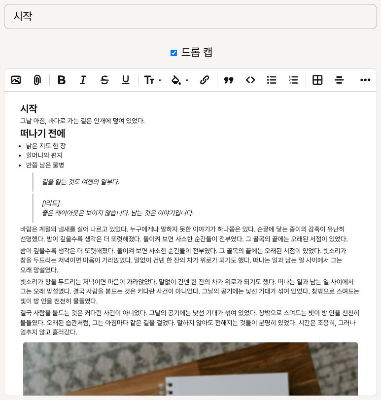
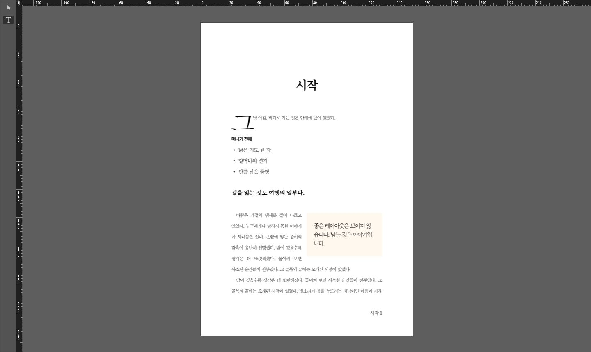

## 마크다운

편집기에는 서식이 있는 글로 저장되지만, 책을 조판할 때는 그 글을 마크다운으로 바꿔서 씁니다. 그래서 마크다운에 익숙하다면 마크다운 문법을 그대로 입력하거나 붙여 넣어도 됩니다. 편집기가 알아서 서식으로 바꿉니다. 마크다운을 몰라도 괜찮습니다. 도구 모음만으로 같은 서식을 모두 넣을 수 있습니다.



## 서식과 인쇄

| 도구 모음 | 마크다운 | 인쇄에서 |
| --- | --- | --- |
| 대제목 | `## 제목` | 큰 제목 |
| 중제목 | `### 제목` | 작은 제목 |
| 소제목 | `#### 제목` | 본문과 같은 글자 |
| 굵게 | ` **굵게** ` | 굵게 |
| 기울임 | `*기울임*` | 기울임 |
| 인용 | `> 인용문` | 인용문 |
| 글머리 기호 목록 | `- 항목` | 글머리 기호 목록 |
| 번호 매기기 목록 | `1. 항목` | 번호 목록 |
| 코드 (블록) | ````` 세 개로 감싸기 | 코드 블록 |
| 코드 (글 안) | ``코드`` | 글자만 |
| 링크 | `[글](주소)` | 글자만 |

목록 안에서 들여 쓰면 하위 목록이 되고, 인쇄에서도 단계가 들어갑니다.

`#` 하나로 쓰는 제목은 본문에 쓰지 않습니다. 문서의 제목은 글쓰기 화면의 제목 칸에 쓰고, 인쇄에서는 문서 첫 쪽의 제목 자리에 들어갑니다. 본문에 `# 제목`이 들어가면 저장할 때 대제목(`##`)으로 바뀝니다. `#`은 여러 문서가 든 원고를 불러올 때 문서를 나누는 표시로만 씁니다([원고 불러오기와 내보내기](/10/bookwrite/128/-) 참고).

밑줄과 색상 강조는 웹에서 읽을 때만 보이고, 인쇄에는 글자만 남습니다. 취소선과 구분선은 인쇄에서 제대로 나오지 않으니 인쇄할 책에는 쓰지 마세요.

이미지, 표, 수식은 각각의 장에서 설명합니다: [이미지 넣기](/10/bookwrite/118/-), [표](/10/bookwrite/119/-), [수식](/10/bookwrite/117/-).

## 리드 상자

인용의 첫 줄에 `[!리드]`라고 쓰면, 그 인용은 인쇄에서 본문 옆에 떠 있는 **리드 상자** 가 됩니다. 옅은 색 바탕에 여백을 두고 글이 상자 가운데에 놓이며, 본문은 상자를 피해 흐릅니다. 잡지의 발췌 인용처럼 눈길을 끌 한 문장에 어울립니다.

```
> [!리드]
> 좋은 레이아웃은 보이지 않습니다. 남는 것은 이야기입니다.
```

편집기에서는 **인용** 을 고르고 `[!리드]`를 쓴 다음, `Shift+Enter`로 줄을 바꿔 글을 씁니다. `[!리드]` 뒤에 줄을 바꾸지 않고 글을 이어 쓰면 보통 인용으로 남습니다.



아무것도 정하지 않으면 상자는 본문 폭의 오른쪽 절반을 차지하고, 글이 놓인 줄에서 시작해 글 높이만큼 자리 잡습니다. 중괄호로 자리와 크기를 정할 수 있습니다. 본문 영역을 세로로 여섯 칸으로 나눈 격자를 기준으로 셉니다.

```
> [!리드]{col: 1, width: 2, v: middle}
> 좋은 레이아웃은 보이지 않습니다.
```

| 속성 | 뜻 | 정하지 않으면 |
| --- | --- | --- |
| `col` | 시작 칸 (1–6, 왼쪽부터) | 오른쪽 끝에 붙음 |
| `width` | 칸 수 | 3 (본문 폭의 절반) |
| `lines` | 높이, 본문 줄 수 | 글 높이만큼 |
| `v` | 쪽의 `top`(위), `middle`(가운데), `bottom`(아래) | 글이 놓인 줄 |

`[!리드]` 대신 `[!lead]`라고 써도 되고, `col` 대신 `starting`, `v` 대신 `v_position`을 써도 됩니다.

리드 상자는 [교정/교열](/10/bookwrite/121/-)에서 **선택 도구** 로 끌어서 옮기거나 크기를 바꿀 수도 있습니다. 옮긴 자리는 중괄호 안의 값으로 저장됩니다.
