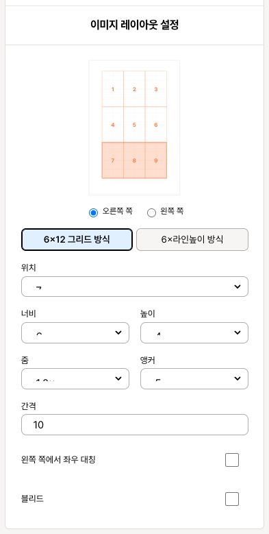
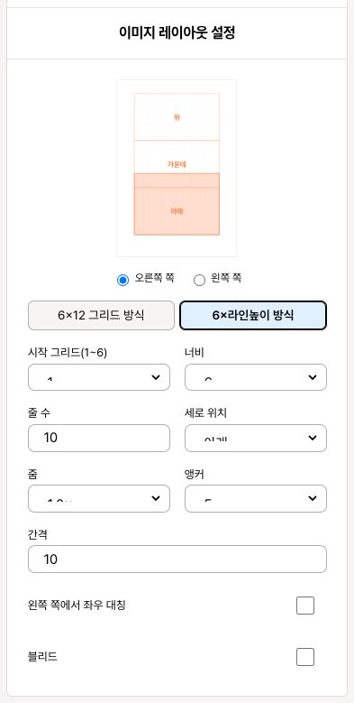
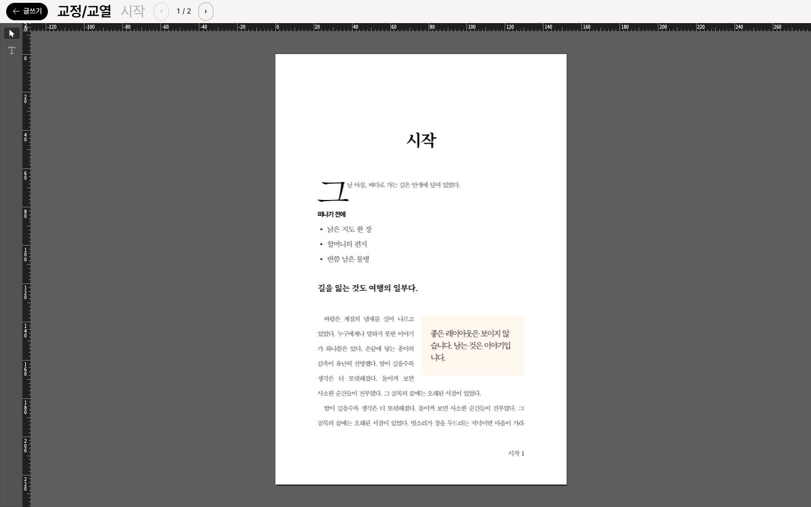

## 이미지 넣기

글쓰기 화면에서 본문에 이미지를 넣고, 인쇄에서 그 이미지가 쪽의 어디에 얼마나 크게 놓일지 정합니다.

## 이미지 넣기

1. 글쓰기 화면에서 이미지를 넣을 자리에 커서를 둡니다.
2. 도구 모음의 **이미지 및 동영상 추가** 를 누르고 이미지 파일을 고릅니다. 파일을 편집기로 끌어다 놓아도 됩니다.
3. 이미지가 그 자리에 들어가고 저절로 저장됩니다.

이미지는 문단 사이에 따로 둡니다. 문장 중간에 들어간 이미지는 인쇄에서 빠집니다.

## 인쇄에서 이미지가 놓이는 방식

인쇄에서 이미지는 쪽 위에 떠 있고, 본문은 이미지를 피해 흐릅니다. 자리는 본문 영역을 **가로 6칸 × 세로 12칸** 으로 나눈 격자로 정합니다. 처음에는 쪽 아래쪽에 본문 폭 가득, 4칸 높이로 놓입니다.

- 이미지는 장의 첫 쪽부터 빈자리가 있는 첫 쪽에 놓입니다. 그래서 글에서 넣은 자리보다 앞쪽에 놓일 수 있습니다.
- 이미지는 정한 상자를 가득 채웁니다. 비율이 다르면 늘이지 않고 넘치는 부분을 잘라 냅니다.
- 이미지 옆에 남는 본문 폭이 2칸보다 좁으면, 글이 한두 자씩 끊기지 않도록 본문이 이미지 옆으로 흐르지 않고 위아래로 건너뜁니다.

## 이미지 레이아웃 설정 패널

편집기에서 이미지를 누르면 오른쪽 **페이지 미리보기** 아래의 **이미지 레이아웃 설정** 패널에 그 이미지의 배치가 나옵니다. 패널 위쪽의 작은 그림에 쪽과 이미지 자리가 그려집니다. 값을 바꾸면 바로 저장되고, 이 그림과 위의 **페이지 미리보기** 도 새로 그려집니다.



방금 넣은 이미지가 패널에 나오지 않으면, 저장한 뒤 화면을 새로 고치세요.

패널에는 배치 방식에 따라 두 탭이 있습니다. 탭을 고르면 이미지가 그 방식으로 바로 배치됩니다.

**6×12 그리드 방식** — 격자 위의 자리와 칸 수로 정합니다.

- **위치** — 1–9. 1 왼쪽 위, 2 가운데 위, 3 오른쪽 위, 4–6 가운데 줄, 7 왼쪽 아래, 8 가운데 아래, 9 오른쪽 아래입니다.
- **너비** — 1–6칸
- **높이** — 1–12칸

**6×라인높이 방식** — 시작 칸과 본문 줄 수로 정합니다. 이미지를 특정 칸에서 시작하게 하거나 높이를 본문 줄에 맞출 때 씁니다.

- **시작 그리드(1~6)** — 이미지가 시작하는 칸, 왼쪽부터
- **너비** — 1–6칸
- **줄 수** — 이미지 높이, 본문 줄 수
- **세로 위치** — **위** , **가운데** , **아래**



두 탭에서 함께 쓰는 값:

- **줌** — 1.0×–5.0×. 이미지를 확대하고, 상자 밖은 잘라 냅니다.
- **앵커** — 확대할 때 어느 부분을 남길지. 숫자 키패드 배열입니다: 7 왼쪽 위, 8 가운데 위, 9 오른쪽 위, 5 가운데, 1 왼쪽 아래, 3 오른쪽 아래. 위치와 번호 배열이 다르니 주의하세요.
- **간격** — 이미지와 본문 사이 여백, pt. 처음은 10입니다.
- **왼쪽 쪽에서 좌우 대칭** — 아래를 보세요.
- **블리드** — 본문 영역 가장자리에 닿은 이미지 변을 종이 끝 너머 재단 여유까지 넓힙니다. 종이 끝까지 꽉 찬 이미지를 만들 때 씁니다.

## 왼쪽 쪽에서 좌우 대칭

위치와 시작 칸은 보통 본문 영역의 왼쪽부터 셉니다. 책을 펼치면 오른쪽 쪽은 책등이 왼쪽에, 왼쪽 쪽은 책등이 오른쪽에 있습니다. **왼쪽 쪽에서 좌우 대칭** 을 켜면 왼쪽 쪽에서는 좌우를 뒤집어 책등부터 셉니다. 그래서 이미지가 어느 쪽에 놓이든 늘 바깥쪽(또는 늘 책등 쪽)에 머뭅니다.

- 위치 3 + 대칭 — 늘 바깥쪽 위
- 위치 1 + 대칭 — 늘 책등 쪽 위
- 시작 칸 1, 너비 2 + 대칭 — 늘 책등 쪽 두 칸

가운데(2, 5, 8)는 그대로입니다. 미리보기 위의 **오른쪽 쪽** / **왼쪽 쪽** 을 고르면 각 쪽에서의 자리를 볼 수 있습니다. 이 선택은 미리보기만 바꾸고 저장되지 않습니다. 실제로는 글이 닿는 쪽에 놓입니다.

## 교정/교열에서 옮기기

[교정/교열](/10/bookwrite/121/-)에서 **선택 도구** 를 고르면 이미지를 쪽 위에서 끌어 옮기고 크기를 바꿀 수 있습니다.

- 옆으로는 칸 단위로 옮기고, 크기는 칸과 본문 줄 단위로 바뀝니다.
- 위아래로는 쪽의 위, 가운데, 아래 중 한 곳에 붙습니다.
- 다른 쪽이나 다른 문단으로는 옮길 수 없습니다. 이미지를 글의 다른 곳으로 옮기려면 글쓰기에서 옮깁니다.

옮기면 바로 저장되고, 배치는 **6×라인높이 방식** 으로 바뀝니다. 줌, 앵커, 간격, 대칭, 블리드는 그대로입니다.



## 해상도

장 안의 이미지는 해상도를 따로 확인해 주지 않습니다. 인쇄할 크기에서 150 ppi보다 낮으면 흐리게 나올 수 있으니 충분히 큰 이미지를 쓰세요. 예를 들어 폭 10cm로 인쇄할 이미지는 가로 600픽셀 이상이 좋습니다. [화보](/10/bookwrite/120/-)에서는 해상도가 낮은 사진에 경고가 나옵니다.

## 배치를 글자로 적기

배치는 글자로도 저장됩니다. 원고를 마크다운으로 내보내면 이미지마다 따옴표 안에 배치가 적혀 있고, 이 값을 고쳐 다시 불러오면 배치가 바뀝니다([원고 불러오기와 내보내기](/10/bookwrite/128/-) 참고).

```


```

| 값 | 패널 | 뜻 |
| --- | --- | --- |
| `float` | 위치 / 세로 위치 | 1–9. 열 방식에서는 1–3 위, 4–6 가운데, 7–9 아래만 뜻합니다 |
| `size` | 너비 × 높이 | 그리드 방식의 칸 수, 예 `2x4` |
| `col` (`column`) | 시작 그리드 | 열 방식의 시작 칸 1–6 |
| `width` | 너비 | 열 방식의 칸 수 1–6 |
| `lines` | 줄 수 | 열 방식의 높이, 본문 줄 수 |
| `zoom_scale` | 줌 | 1.0–5.0 |
| `zoom_anchor` | 앵커 | 1–9 |
| `gap` | 간격 | pt |
| `bleed` | 블리드 | `true` / `false` |
| `mirror` | 왼쪽 쪽에서 좌우 대칭 | `true` / `false` |

`col`이 있으면 열 방식, 없으면 그리드 방식입니다.
