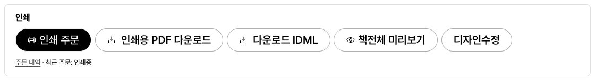
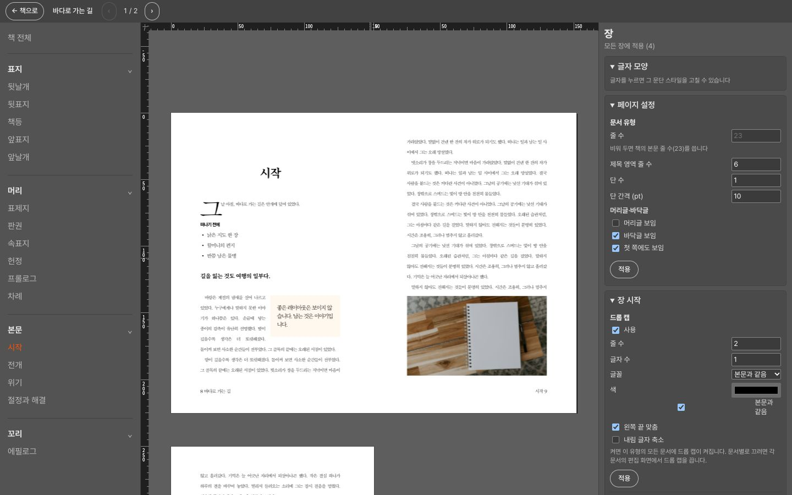
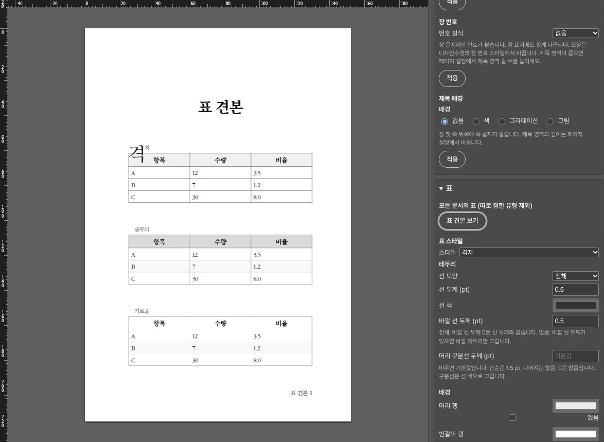
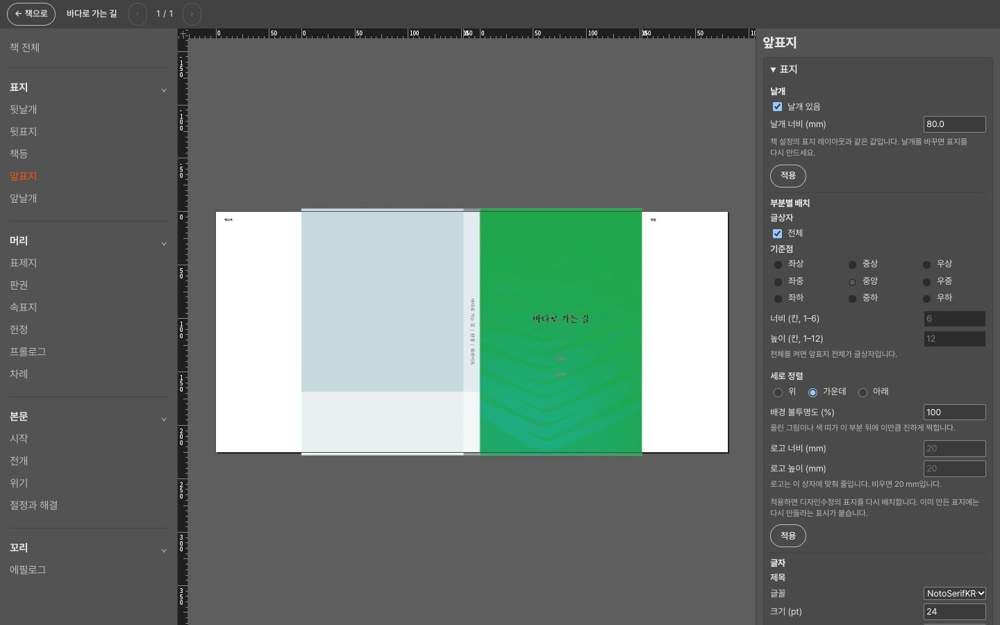

## 디자인수정

책마다 자기 디자인이 있습니다. 책을 만들 때 고른 디자인 테마(클래식, 모던 등)를 복사해 이 책의 디자인으로 삼고, 그 뒤로는 **디자인수정** 에서 이 책의 디자인만 고칩니다. 다른 책이나 테마에는 영향이 없습니다. 여백, 머리글·바닥글, 장 시작, 글자 모양, 표, 표지의 배치와 글자를 여기서 정합니다. 글의 내용은 [글쓰기](/10/bookwrite/115/-)나 [교정/교열](/10/bookwrite/121/-)에서 고칩니다.

## 디자인수정 열기

책의 개요 화면에서 **인쇄** 카드의 **디자인수정** 을 누릅니다. 앞표지, 책등, 뒷표지 패널 편집 화면의 **Layout** 탭에 나오는 **디자인수정 열기** 링크로도 열 수 있습니다. 디자인수정은 따로 한 화면을 씁니다. 위쪽 막대에는 **← 책으로** , 책 제목, 펼침면을 넘기는 \*\*‹ ›\*\*가 있고, **← 책으로** 를 누르면 책으로 돌아갑니다.

창은 세 칸입니다.

- **왼쪽: 책 구성** — 책의 차례를 따라 늘어선 항목입니다.
- **가운데: 쪽** — 고른 항목의 쪽만 나옵니다(메뉴나 패널은 없습니다). 글을 누르면 그 글자 모양이 오른쪽에 나옵니다. 위와 왼쪽의 자는 쪽마다 그 쪽의 왼쪽 위 모서리부터 mm로 잽니다(교정/교열 화면도 같습니다). 위쪽 막대의 \*\*‹ ›\*\*로 앞뒤 펼침면으로 넘기면, 그 펼침면이 가운데에 꼭 맞게 나옵니다. 가운데에 "2 / 7"처럼 지금 펼침면과 전체 펼침면 수가 나옵니다. 키보드의 ←·↑(앞)과 →·↓(뒤)로도 넘깁니다(설정 칸에 입력하는 중에는 넘기지 않습니다).
- **오른쪽: 설정** — 고른 항목의 설정입니다. 창이 좁으면 쪽 아래에 놓입니다.

처음 열 때 내용이나 디자인이 바뀐 뒤라면 "디자인수정 준비 중 — 디자인 견본을 배치하고 있습니다"와 기다린 시간이 나옵니다. 보통 몇 초 걸립니다. 이 책의 글꼴을 아직 받지 않았다면 쪽 자리에 "글꼴 불러오는 중 (1/3)"처럼 진행이 먼저 나옵니다. [교정/교열](/10/bookwrite/121/-)과 같습니다.

## 책 구성

맨 위의 **책 전체** 아래로 **표지** (뒷표지·책등·앞표지, 날개가 있으면 앞날개·뒷날개), **머리** (표제지·판권·속표지·차례·서문 같은 앞쪽 문서), **본문** (장, 파트 표지, 장 표지, 화보, 시), **꼬리** 가 이어집니다. 무리마다 접을 수 있습니다.

항목을 누르면 가운데에 그 항목의 쪽이 나옵니다. 책 전체를 이어 배치한 쪽이 아니라 그 문서만 따로 배치한 쪽이지만, 책에서 놓이는 자리 그대로입니다. 왼쪽 쪽인지 오른쪽 쪽인지(제본 여백이 안쪽에 붙습니다), 쪽 번호, 오른쪽 쪽에서 시작하느라 앞에 들어가는 빈 쪽까지 책과 같습니다. 처음 고른 항목은 배치하느라 잠시 기다립니다(진행 시간이 표시됩니다). 지금 항목의 앞뒤 항목은 미리 배치해 두므로, 옆 항목으로 옮기면 금방 나옵니다.

내용이나 디자인을 고친 뒤에는 상태 줄에 잠시 \*\*쪽 번호를 맞추는 중…\*\*이 나올 수 있습니다. 책 전체의 쪽을 다시 세는 동안 1쪽부터 배치한 쪽을 먼저 보여 주고, 다 세면 제자리에 다시 배치한 쪽으로 바뀝니다. 다시 세어도 자리를 정하지 못하면 **쪽 번호를 맞추지 못했습니다** 가 나오고 1쪽부터 배치한 쪽이 그대로 남습니다.

## 설정 칸

설정 칸 맨 위에는 쪽에서 누른 글의 **글자 모양** 이 나옵니다(아래 **글자 모양 고치기** ). 그 아래에 고른 항목의 이름과, 그 설정이 미치는 범위가 나옵니다. 예를 들어 장을 고르면 **장 · 모든 장에 적용 (12)** — 이 책의 장 12편이 모두 같은 설정을 씁니다. 그 아래에 항목의 설정이 묶음마다 접을 수 있는 카드로 나옵니다. 접은 카드는 다시 열거나 다른 항목으로 옮겨도 접힌 채로 있습니다(책마다, 이 브라우저에서).

| 고른 항목 | 설정 |
| --- | --- |
| 책 전체 | 페이지 설정(여백과 본문 줄 수, 머리글·바닥글), 장 시작(제목 위치) |
| 문서(장, 서문, 차례 등) | 그 문서 유형의 페이지 설정, 그 유형에 해당하는 장 시작, 그리고 표(본문 글이 있는 유형) |
| 장 표지 | 표제지의 설정( **장 표지와 표제지에 적용** ) |
| 자기 디자인이 없는 문서 | "장의 디자인을 따릅니다"와 **장 열기** 버튼 — 장에서 고칩니다 |
| 표지의 한 부분 | 날개, 그 부분의 배치와 글자 |

설정은 부분마다 따로 **적용** 합니다. 적용하면 가운데 쪽을 다시 배치하고, 교정/교열과 책전체 미리보기, 인쇄도 이 디자인을 따릅니다(표지는 다음에 만드는 표지부터). 다른 부분을 적용하거나 쪽을 다시 배치하는 동안에는 적용할 수 없습니다. 쪽을 배치하는 동안에는(처음 열 때, 적용한 뒤, 다른 항목으로 옮길 때) 설정 칸의 값도 바꿀 수 없습니다. 배치가 끝나면 설정 칸이 새 값으로 다시 나오고, 그때부터 고칠 수 있습니다. 맞지 않는 값은 그 칸 옆에 이유가 나오고, 아무것도 저장하지 않습니다. 예를 들어 여백이 너무 커서 글이 놓일 폭이 20 mm보다 작아지는 경우입니다.

## 글자 모양 고치기

가운데 쪽의 글(본문, 제목, 표의 칸, 머리글·바닥글 등)을 누르면 그 문단 스타일이 설정 칸 맨 위의 **글자 모양** 에 나옵니다. 맨 위에는 스타일 이름과 미치는 범위(예: **모든 장에 적용** , 다른 유형도 같이 쓰면 **서문에도 적용** )가 나오고, 그 아래에 한 줄로 늘어선 칸에서 **글꼴** , **굵기** , **크기 (pt)**, **자간 (pt)**, **색** , **정렬** , **왼쪽 들여쓰기 (pt)**, **오른쪽 들여쓰기 (pt)**, \*\*첫 줄 들여쓰기 (pt)\*\*를 바꾸고, 그 뒤에서 간격을 바꿉니다.

- 본문 줄에 맞춰 놓이는 스타일(본문, 글 속의 제목, 목록, 인용 등)은 \*\*앞 간격 (줄)\*\*과 \*\*뒤 간격 (줄)\*\*을 줄 단위(0–10줄)로 정합니다. 그래야 글이 본문 줄에 맞습니다.
- 제목 영역에 따로 놓이는 스타일(장 제목과 부제, 장 번호, 리드, 표제지·속표지·파트 표지의 제목·부제·지은이·출판사)은 \*\*앞 간격 (pt)\*\*과 \*\*뒤 간격 (pt)\*\*을 정합니다.
- 판권 본문은 **뒤 간격 (pt)**(문단 사이)과 **줄 간격 추가 (pt)**(줄 높이에 더해짐)를 정합니다.

표제지·속표지·파트 표지의 제목, 부제, 저자, 출판사는 장 제목과 따로 그 쪽만의 스타일로 찍힙니다. 표제지의 제목 스타일을 고쳐도 장 제목의 스타일은 바뀌지 않습니다. 장 제목 영역의 제목·부제, 판권의 본문, 차례의 제목처럼 배치하면서 따로 만든 글도 누르면 그 글이 따르는 스타일이 바로 열립니다.

머리글·바닥글에는 간격이 없습니다. 두 유형이 같이 쓰는 스타일은 고른 항목의 유형에 맞는 간격이 나옵니다. 다른 문서 유형도 같이 쓰는 스타일은 그곳에도 함께 바뀌고, 그 유형에 값이 따로 정해져 있으면 바뀌지 않는다고 알려 줍니다.

바꾼 뒤 **적용** 을 누르면 이 책의 디자인에 저장하고 쪽을 다시 배치합니다. 다른 설정과 같이 미리보기와 인쇄에도 반영되고, 따로 저장하거나 되돌리는 단추는 없습니다. 쪽을 다시 배치한 뒤에도 고르던 스타일이 그대로 나오고, 다른 항목으로 옮기면 비워집니다. 글이 없는 곳을 누르면 안내만 나옵니다.

고칠 수 없는 스타일은 값과 이유만 나옵니다. 예를 들어 **책 전체** 의 본문은 "이 글자 모양은 장에서 바꿉니다"라고 나오고, 다른 스타일에서 오는 스타일은 그 스타일을 여는 단추가 나옵니다. 표지의 글자는 표지의 **글자** 설정에서 고칩니다.

글의 내용은 여기서 바꿀 수 없습니다(글은 **글쓰기** 나 **교정/교열** 에서 고칩니다).

고친 스타일은 그 문서 유형 전체에 적용됩니다. 장의 본문 스타일을 바꾸면 모든 장의 본문이 바뀝니다. 서문·추천사처럼 장과 같은 스타일을 쓰는 문서는 그 스타일도 함께 바뀝니다.

## 책 전체

책 전체의 설정은 모든 문서에 같습니다. 가운데에는 첫 장의 쪽이 나옵니다. 보기만 할 수 있고, 글자 모양은 장에서 바꿉니다.

**페이지 설정 (책 전체)**

- **페이지** — 위·아래·안쪽·바깥 여백(mm)과 본문 줄 수. 행간은 따로 정하지 않습니다. 글이 놓이는 높이를 본문 줄 수로 나눈 값입니다. 제본 여백은 **책 설정 › 레이아웃 설정** 에서 바꿉니다.
- **머리글·바닥글** — 쪽 위(머리글)와 아래(바닥글)에 찍히는 글입니다. 왼쪽은 짝수 쪽, 오른쪽은 홀수 쪽에 놓이고, 칸마다 글상자에서 떨어진 거리(0–40 mm)를 정합니다. 칸을 누른 뒤 **쪽 번호** , **전체 쪽수** , **책 제목** , **장 제목** , **지은이** 단추를 누르면 그 자리에 `{{page}}` 같은 자리표시자가 들어가고, **굵게** 는 고른 글자를 `**`로 감쌉니다. 내용은 책 전체에 같고, 어느 문서 유형에 찍을지는 그 문서의 설정에서 정합니다. 글자 모양은 쪽의 머리글·바닥글을 눌러 바꿉니다.

**장 시작**

- **제목 위치** — 장 제목을 제목 영역의 위·가운데·아래 중 어디에 놓을지 정합니다. 장과 같은 형식으로 배치하는 모든 문서(서문·추천사 등)가 따릅니다. 시와 표지는 제외됩니다. 제목 영역의 깊이는 각 문서의 **제목 영역 줄 수** 에서 바꿉니다.

## 문서

장·서문·차례 같은 문서를 고르면 그 문서 유형의 설정이 나옵니다. 유형은 정해져 있어 고를 필요가 없고, 바꾼 값은 그 유형의 모든 문서에 적용됩니다. 장 표지는 표제지의 설정을 씁니다. 화보는 장, 시는 시의 설정입니다. 서문·추천사처럼 자기 디자인이 없는 유형은 장의 디자인을 따르므로 설정 대신 안내가 나오고, **장 열기** 를 누르면 첫 장으로 갑니다.

**페이지 설정**

- **줄 수** — 그 유형만의 줄 수입니다. 비워 두면 책의 본문 줄 수를 씁니다.
- **제목 영역 줄 수** — 장·시·차례의 제목 영역입니다. 표제지·속표지·파트 표지에서는 제목이 아래쪽에 놓일 때만 쓰입니다.
- **단 수와 단 간격** — 장·시 같은 본문 유형에만 있습니다.
- **머리글 보임, 바닥글 보임, 첫 쪽에도 보임** — 그 유형에 머리글과 바닥글을 찍을지 정합니다. 표제지·속표지·판권·차례·파트 표지는 처음에 꺼져 있습니다. 표제지·속표지·판권·파트 표지는 한 쪽뿐이라 첫 쪽에도 보임이 없고, 표제지 설정은 장 표지에도 적용됩니다.

**장 시작** — 그 유형에 해당하는 것만 나옵니다.

- **드롭 캡** — 문단 첫 글자를 크게 내려 앉히는 장식입니다(장과, 책에 있는 서문·추천사 같은 유형).
  - **사용** — 이 유형에 드롭 캡을 찍을지 정합니다.
  - **줄 수** (2–6)와 **글자 수** (1–4) — 몇 줄 깊이로, 첫 몇 글자를 크게 할지 정합니다.
  - **글꼴** 과 **색** — **본문과 같음** 을 고르면 본문의 글꼴과 색을 씁니다.
  - **왼쪽 끝 맞춤** , **내림 글자 축소** — 큰 글자의 왼쪽 여백 없이 본문 왼쪽 끝에 맞추고, 아래로 내려가는 획이 있는 글자를 줄여 줄 안에 들어가게 합니다.
  - 유형의 드롭 캡을 켜면 그 유형의 모든 문서에 **드롭 캡** 이 켜집니다. 어떤 문서에서만 빼려면 그 문서의 편집 화면에서 드롭 캡을 끕니다.

- **오른쪽 쪽에서 시작** — 이 유형의 문서가 왼쪽 쪽에 떨어지면 앞에 빈 쪽을 넣어 오른쪽 쪽에서 시작하게 합니다. **표제지·장 표지** 와 파트 표지가 처음부터 켜져 있습니다. 화보는 장을 따릅니다. 쪽수와 책등 두께가 바뀔 수 있습니다.
- **장 번호** — 장에만 있습니다. 장 제목 위에 번호를 붙입니다(제 1 장, Chapter 1 등). 형식을 고르거나 **직접 입력** 에 {n}(숫자), {nn}(두 자리), {N}(로마 숫자)을 넣어 씁니다. 장 문서에만 책 처음부터 차례로 붙고, 장 표지에도 함께 나옵니다. 모양은 쪽의 장 번호를 눌러 글자 모양에서 바꿉니다. 제목 영역이 좁으면 제목 영역 줄 수를 늘리세요.
- **제목 배경** — 첫 쪽의 제목 뒤에 색, 그라데이션(두 색과 각도), 그림(JPG·PNG, 불투명도)을 깝니다. 자기 디자인이 없는 유형은 장의 배경을 씁니다. 쪽 위와 바깥 끝까지 깔리고 제목 영역 아래에서 끝납니다. 판형을 바꾸면 올린 그림은 다시 올려야 합니다.

**표** — 장(화보 포함)·시, 그리고 서문 같은 앞뒤 문서처럼 본문 글이 있는 유형에 나옵니다. 책 전체에는 없습니다.

- **본문 유형의 표** — 책의 본문 유형(장, 장이 없는 시집에서는 시)의 표가 모든 문서의 기본 표입니다. 그 유형에서는 머리에 \*\*모든 문서의 표 (따로 정한 유형 제외)\*\*라고 나옵니다.
- **다른 유형** — 처음에는 **장의 표를 씁니다** (또는 **시의 표를 씁니다** )라고 나오고, 값은 흐리게 보이기만 합니다. **이 유형의 표 따로 만들기** 를 누르면 본문 유형의 표를 복사해 이 유형만의 표로 고칠 수 있습니다. **장의 표로 되돌리기** 는 이 유형의 표 스타일과 셀 글자를 지우고 다시 장의 표를 쓰게 합니다.
- **표 스타일** — 격자·줄무늬·가로줄·최소·단순 중 하나를 골라 테두리(선 모양, 선 두께, 선 색, 바깥 선 두께, 머리 구분선 두께), 배경(머리 행, 번갈이 행, 또는 없음), 글자(머리·본문 글자색, 머리 굵게, 칸 여백)를 바꿉니다. 머리 구분선을 비우면 단순은 1.5 pt, 나머지는 없음입니다. **처음대로** 는 그 스타일을 시작 테마의 값으로 되돌립니다.
- **셀 글자** — 모든 스타일의 머리 칸과 본문 칸의 글꼴(비우면 본문 글꼴), 크기, 정렬, 세로 정렬입니다. 표 스타일과 같이, 다른 유형에서는 그 유형의 표를 따로 만든 뒤에 고칠 수 있습니다. 표의 칸을 눌러 글자 모양에서도 바꿀 수 있습니다.
- **표 견본 보기** — 가운데에 다섯 스타일의 표를 담은 **표 견본** 을 그 유형의 표로 배치해 보여 줍니다. 책 구성에서 고른 항목은 그대로이고, 다른 항목을 누르면 견본에서 나갑니다.

- **정리** — 본문 유형이 되기 전에 따로 만든 표가 남아 있으면 본문 유형에 안내와 함께 나옵니다. 남은 표는 쓰이지 않으니 눌러 지웁니다.

글쓰기에서 표마다 스타일을 고르는 것과 **책 설정 › 레이아웃 설정** 의 기본 표 스타일은 그대로입니다. 표에 대해서는 [표](/10/bookwrite/119/-)를 참고하세요.

## 표지

표지의 한 부분(뒷표지·책등·앞표지·앞날개·뒷날개)을 고르면 가운데에 그 부분이 나오고, 설정 칸에 **날개** 와 그 부분의 **배치** , **글자** 가 나옵니다. 부분을 적용하면 표지를 다시 배치하고, 이미 만든 표지에는 다시 만들라는 표시가 붙습니다.

표지에 쓰는 글과 그림은 표지 편집에서 넣습니다([표지](/10/bookwrite/124/-) 참고).

- **날개** — 날개 있음과 날개 너비(mm)입니다. **책 설정 › 레이아웃 설정** 의 날개 값과 같습니다. 날개 너비는 앞표지 너비보다 클 수 없습니다. 날개를 켜거나 끄면 책 구성의 앞날개·뒷날개도 함께 생기거나 없어집니다. 날개를 바꾼 뒤에는 표지를 다시 만드세요.
- **배치** — 부분마다 다릅니다.
  - **앞표지** — 글상자(3 × 3 기준점과 너비 1–6칸·높이 1–12칸, 또는 **전체** ), 세로 정렬, 배경 불투명도(0–100 %), 로고 크기(mm, 비우면 20 mm; 로고는 이 상자에 맞춰 줄입니다)입니다.
  - **책등** — 배경 불투명도와 로고 크기입니다. 로고는 책등 너비를 넘지 않습니다.
  - **뒷표지** — 배경 불투명도입니다. 글·그림 위치는 표지 편집에서 바꿉니다.
  - **앞날개** — 저자 사진의 너비·높이(칸), 기준점, 맞춤(채우기·맞추기), 테두리 두께와 색입니다.
  - **뒷날개** — 홍보할 책 그림의 너비(날개 글 폭의 10–40 %), 그림 비율(높이 ÷ 너비), 책 사이 간격(pt)입니다.

- **글자** — 그 부분의 글자마다 글꼴, 크기, 색, 정렬을 바꿉니다(앞표지: 제목·부제·저자·출판사, 책등: 제목·저자·출판사, 뒷표지: 본문, 날개: 머리글·책 제목·책 소개 또는 이름·소개). 날개 머리글은 따로 바꾸기 전까지 책 제목과 같은 글자를 씁니다.

자기 디자인이 있는 책은 표지 패널 편집 화면의 **Layout** 탭에 불투명도 막대 대신 이곳으로 가는 안내가 나옵니다. 글꼴과 글자 크기는 **글자** 에서 바꿉니다.

## 테마와 판형

디자인 테마와 판형은 **책 설정 › 레이아웃 설정** 에서 고릅니다. 디자인 테마 목록 맨 위의 **이 책** 묶음에 \*\*(이 책의 디자인)\*\*이라고 붙은 것이 지금 이 책의 디자인입니다. 다른 테마나 판형을 고르면 이 책의 디자인을 새로 만들기 때문에 디자인수정에서 바꾼 내용은 사라집니다. 고르기 전에 "이 책의 디자인을 새로 만듭니다. 디자인수정에서 바꾼 내용은 사라집니다. 판형은 디자인을 따릅니다. 계속할까요?"라고 한 번 묻습니다.

디자인은 판형이 하나씩이고, 같은 모양의 다른 판형은 다른 디자인입니다(예: 클래식 사륙판). 목록에서는 **classic · 신국판** 처럼 디자인 이름 뒤에 판형이 붙습니다. 디자인을 고르면 책의 판형도 그 디자인의 판형으로 바뀌고, "판형은 디자인을 따라 사륙판입니다."처럼 알려 줍니다. 디자인에 없는 판형을 고르면 바꾸지 않고, 그 판형으로 된 디자인 이름을 알려 줍니다. 판형을 바꾸려면 그 판형의 디자인을 고르세요.

테마 자체는 디자이너가 book\_design에서 만들어 `.book_design` 파일로 BookWrite에 들여옵니다([테마 가져오기](/10/bookwrite/134/-) 참고). 이 파일에 문서 유형별 쪽 틀이나 표지가 들어 있으면, 그 디자인을 쓰는 책은 그 틀과 표지로 배치됩니다.

자기 디자인이 아직 없는 책에서는 설정 칸에 "이 책에는 아직 고유 디자인이 없어 저장할 수 없습니다"가 나오고, 아무것도 고칠 수 없습니다.
