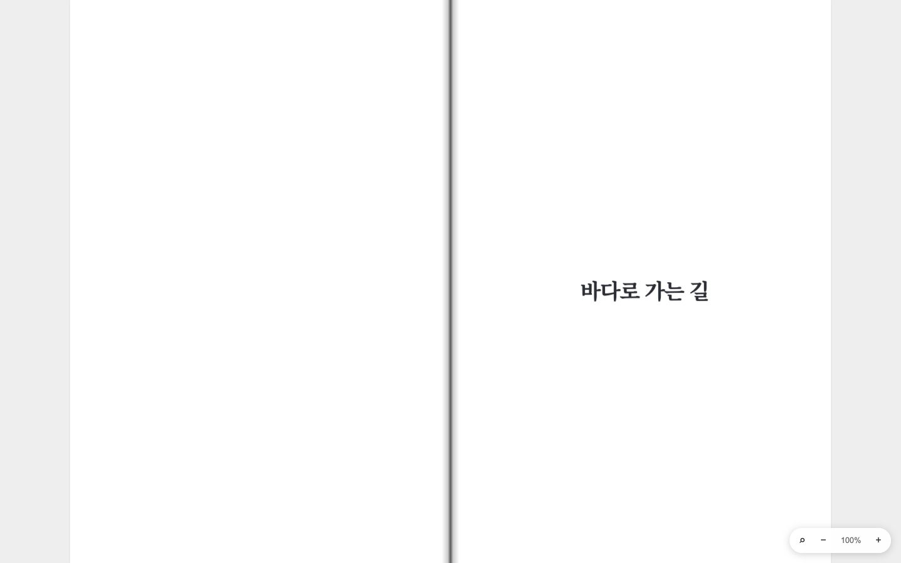

## 자동으로 만드는 쪽

책을 만들면 BookWrite가 표제지, 판권, 속표지, 빈 페이지를 함께 만듭니다. 차례도 따로 쓰지 않아도 됩니다. 이 쪽들은 **책전체 미리보기** 와 인쇄본에 들어갑니다.

이 가운데 직접 고치는 문서는 **판권** 하나입니다. 나머지는 목차에 나오지 않고, 책의 정보와 설정에서 만들어집니다.

| 쪽 | 목차에 | 내용이 오는 곳 |
| --- | --- | --- |
| 표제지 | 없음 | 책 제목 |
| 판권 | **머리** (또는 **꼬리** ) | 판권 문서의 글 |
| 속표지 | 없음 | 책 제목, 부제, 저자, 출판사 |
| 빈 페이지 | 없음 | 내용 없음 |
| 차례 | 없음 | 책의 문서 제목과 쪽 번호 |
| 장 표지 | 없음 | 각 장의 제목(과 장 번호) |
| 면지 | 없음 | 내용 없음 |

## 책 앞쪽의 차례

책 앞쪽은 이 차례로 놓입니다.

1. 표제지
2. 판권
3. 속표지
4. 빈 페이지
5. 헌사·서문·추천사 같은 앞쪽 문서(목차의 **머리** 에 넣은 문서)
6. 차례

그 뒤로 **본문** 과 **꼬리** 의 문서가 이어집니다.

## 표제지와 속표지

**표제지** 에는 책 제목이, **속표지** 에는 책 제목·부제·저자·출판사가 찍힙니다. 이 정보는 **책 설정 › 책 기본 정보** 에서 고칩니다. 고치면 다음 미리보기부터 바뀝니다.

제목, 부제, 저자, 출판사는 저마다 제 글자 모양으로 찍힙니다. 장 제목의 글자 모양과는 따로이므로, 장 제목의 글자 모양을 바꿔도 표제지·속표지·파트 표지의 글자는 그대로입니다. 이 글자 모양은 [디자인수정](/10/bookwrite/122/-)에서 표제지나 속표지를 고른 뒤 쪽의 글자를 눌러 바꿉니다.

## 판권

**판권** 은 목차의 **머리** 에 있는 보통 문서입니다. 눌러서 글쓰기에서 다른 문서처럼 고칩니다. 처음에는 저자, 출판사, ISBN을 넣은 견본 글(지은이, 발행처, 출판등록, 주소, 전화, 홈페이지, ISBN)이 들어 있습니다. 이 글은 책을 만들 때 한 번 채워지므로, 나중에 책 기본 정보를 바꾸면 판권 글도 직접 고쳐 주세요. 출판등록 번호, 주소, 전화도 실제 값으로 바꿔야 합니다.

**책 설정 › 책 구조 설정** 에서 **판권을 책 뒤에 배치** 를 켜면 판권이 목차의 **꼬리** 맨 끝으로 옮겨지고 책의 마지막에 찍힙니다. 이때 책 앞쪽은 표제지, 빈 페이지, 속표지 순서가 됩니다.

판권의 글자 모양과 간격은 [디자인수정](/10/bookwrite/122/-)에서 바꿉니다.

## 차례

**차례** 는 표제지·판권·속표지·빈 페이지를 뺀 모든 문서를 목차 순서대로, 책에서의 쪽 번호와 함께 싣습니다. 파트 표지와 장 표지는 한 단계 위로, 나머지 문서는 그 아래로 들어갑니다. 문서를 더하거나 지우거나 순서를 바꾸면 다음 미리보기에서 차례도 바뀝니다.

책전체 미리보기에서는 차례의 항목을 누르면 그 문서로 넘어갑니다.

## 장 표지

**책 설정 › 책 구조 설정** 의 **장 표지** 를 켜면 각 장과 시 앞에 그 제목을 담은 장 표지가 한 쪽씩 들어갑니다. 장 번호를 쓰는 책은 장 표지에도 장 번호가 나옵니다. 장 표지는 표제지의 디자인을 따릅니다.

## 빈 페이지와 면지

- **빈 페이지** — 속표지 다음에 들어가는 빈 쪽 하나입니다.
- **오른쪽 쪽에서 시작** — 디자인수정에서 이 설정을 켠 문서 유형(처음에는 표제지·장 표지와 파트 표지)이 왼쪽 쪽에 떨어지면, 그 앞에 빈 쪽이 하나 들어갑니다.
- **면지** — 표지와 본문 사이에 넣는 빈 종이입니다. **책 설정 › 레이아웃 설정** 의 \*\*면지 (앞뒤)\*\*에서 **없음** , **1장 (2페이지)**, **2장 (4페이지)** 가운데 고릅니다. 고른 만큼 책 앞과 뒤에 각각 들어갑니다.

빈 쪽이 들어가면 전체 쪽수와 책등 두께가 바뀔 수 있습니다.

## 웹에서 읽을 때

웹에서 책을 읽을 때는 판권만 문서로 보이고, 표제지·속표지·빈 페이지·차례·장 표지·면지는 나오지 않습니다. 이 쪽들은 [책 미리보기](/10/bookwrite/127/-)와 인쇄본에서 확인하세요.
