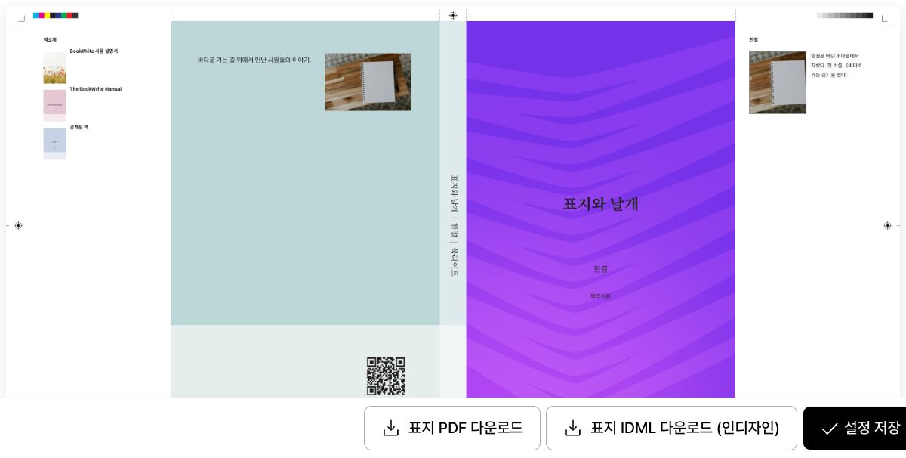
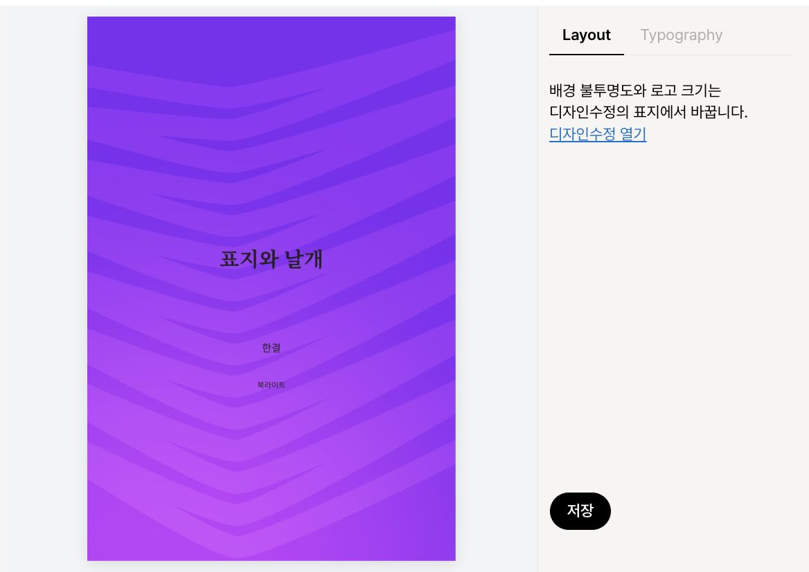
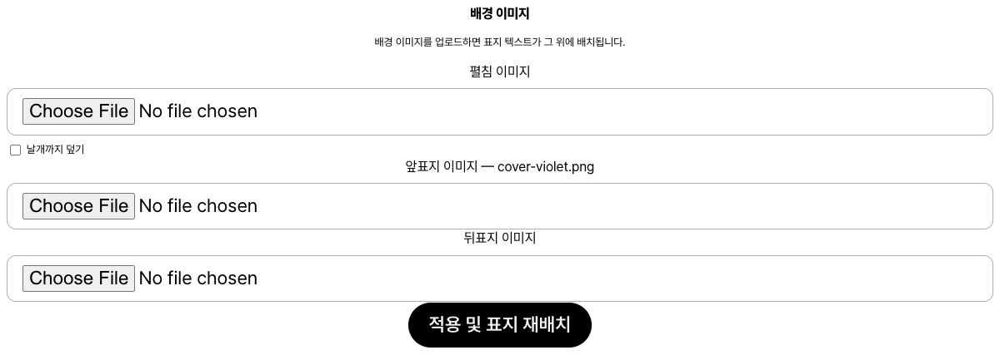
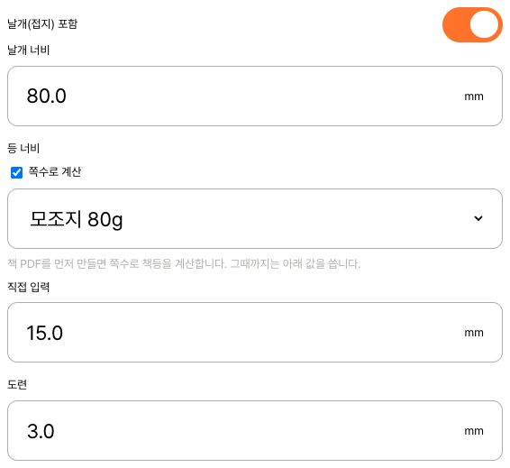
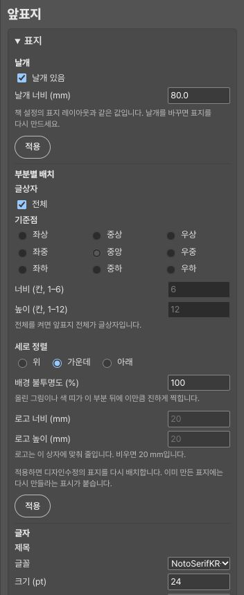

## 표지

BookWrite의 표지는 인쇄소에 그대로 보낼 수 있는 펼침 표지 한 장입니다. 뒤표지, 등(책등), 앞표지의 세 부분으로 되어 있고, 날개를 켜면 뒷날개와 앞날개가 더해져 다섯 부분이 됩니다. 표지는 본문과 따로 조판되며, 표지 PDF와 인디자인(IDML) 파일로 내려받을 수 있습니다.

```
┌──────┬──────────┬────┬──────────┬──────┐
│뒷날개│ 뒤표지 │ 등 │ 앞표지 │앞날개│
│ │ │ │ │ │
└──────┴──────────┴────┴──────────┴──────┘
```

## 표지 편집 탭

책을 만들면 표지도 곧바로 만들어지므로, 새 책도 서재와 책 개요에 처음부터 표지가 보입니다. 제목·부제·저자·출판사는 책 정보에서 가져오고, 배경에는 밝은 두 가지 색의 띠가 무작위로 깔립니다. 위쪽 ¾은 한 색, 아래쪽 ¼은 다른 색으로 뒤표지, 등, 앞표지에 걸쳐 깔리고, 날개에는 깔리지 않습니다. 배경 이미지를 올리면 그 그림이 색 띠 대신 쓰입니다.

책 위쪽의 **표지 편집** 탭을 누르면 표지 화면이 열립니다.



화면에는 다음이 있습니다.

- **미리보기** — 펼친 표지 전체입니다. 각 부분 위에 그 너비(mm)가 적혀 있고, 도련선과 맞춤표도 보입니다. **각 영역을 클릭하면 편집할 수 있습니다.**
- **배경 이미지** — 표지에 깔 그림을 올리는 곳입니다(아래 참고).
- 화면 아래쪽 버튼 — **표지 PDF 다운로드** , **표지 IDML 다운로드 (인디자인)**. 표지 PDF 버튼은 표지를 한 번 만든 뒤에 눌러집니다.

왼쪽 목차의 **표지** 아래에 있는 **앞표지** , **뒤표지** , **등** , **앞날개** , **뒷날개** 를 눌러도 같은 편집 화면이 열립니다.

## 앞표지와 등 편집

앞표지나 등을 누르면 왼쪽에 그 부분의 미리보기, 오른쪽에 편집 칸이 있는 화면이 열립니다. 미리보기에서 글자를 누르면 그 글자의 칸으로 바로 이동합니다.



- **Layout** 탭(처음 열리는 탭) — 책에 자기 디자인이 없으면 여기서 **이미지 투명도** 를 조절합니다. 자기 디자인이 있는 책에는 "배경 불투명도와 로고 크기는 디자인수정의 표지에서 바꿉니다."라는 안내와 **디자인수정 열기** 링크가 보입니다.
- **Typography** 탭 — 제목, 부제, 저자, 출판사의 글자와 **로고** 그림 파일을 넣습니다. 등에는 부제가 없습니다.

**저장** 을 누르면 표지 전체가 다시 배치되고 미리보기가 바뀝니다.

> **참고** : 표지의 글자는 표지를 처음 만들 때 책 정보에서 한 번 옮겨 옵니다. 그 뒤에 책 제목이나 저자를 바꿔도 표지 글자는 그대로이니, 표지에서도 고쳐 주세요.

뒤표지는 [뒷표지 배치](/10/bookwrite/125/-)에서, 날개는 [날개: 저자 소개와 홍보 도서](/10/bookwrite/126/-)에서 설명합니다.

## 배경 이미지

표지 편집 탭의 **배경 이미지** 에서 그림을 올립니다. 그림을 올리면 표지 글자가 그 위에 배치됩니다.

| 항목 | 그림이 깔리는 곳 |
| --- | --- |
| **펼침 이미지** | 뒤표지 + 등 + 앞표지 |
| **펼침 이미지** + **날개까지 덮기** | 날개를 포함한 다섯 부분 전체 (날개가 있을 때만 보입니다) |
| **앞표지 이미지** | 앞표지만 |
| **뒤표지 이미지** | 뒤표지만 |

파일을 고른 뒤 **적용 및 표지 재배치** 를 누르면 표지가 다시 배치됩니다. 앞표지 이미지나 뒤표지 이미지는 펼침 이미지 위에 덧깔리므로, 둘을 함께 쓸 수 있습니다. 그림을 바꾸려면 새 파일을 올리면 됩니다. 그림이 하나도 없으면 색 띠가 배경이 됩니다.

배경이 얼마나 진하게 찍힐지는 부분마다 정합니다(디자인수정의 **배경 불투명도** , 또는 자기 디자인이 없는 책은 편집 화면의 **이미지 투명도** ).



## 서재에 보이는 표지

표지를 만들 때마다 앞표지가 그 책의 표지 그림이 되어 서재와 책 개요에 보입니다. 따로 올릴 필요가 없습니다. 직접 만든 표지 그림을 쓰고 싶다면 **앞표지 이미지** 로 올리세요.

반대로, 서재의 표지 그림은 표지의 배경으로 쓰이지 않습니다. 예를 들어 복제한 책에서 표지 편집을 처음 열면 새 표지가 색 띠로 만들어지고, 원본에서 가져온 표지 그림은 앞표지 배경이 되지 않습니다. 같은 그림을 깔려면 **앞표지 이미지** 로 올리세요.

## 표지 다시 만들기

부분을 저장하거나 배경 이미지를 적용하면 표지는 바로 다시 만들어집니다. 하지만 디자인수정에서 표지 디자인을 바꾸면 이미 만든 표지는 저절로 바뀌지 않습니다. 그때는 표지 편집 탭 위쪽에 다음 안내가 나타납니다.

> 디자인이 바뀌었습니다. 표지를 다시 만드세요.

옆의 **표지 다시 만들기** 를 누르면 새 디자인으로 다시 만들어집니다. 표지 PDF나 IDML을 내려받을 때도 표지가 디자인보다 오래되었으면 먼저 다시 만든 뒤 내려받습니다.

## 날개, 책등, 용지: 레이아웃 설정

날개와 책등의 크기는 **책 설정 › 레이아웃 설정** 에서 정합니다.

- **날개(접지) 포함** — 켜면 앞날개와 뒷날개가 생깁니다. **날개 너비** (mm)도 여기서 정합니다.
- **등 너비** — **쪽수로 계산** 을 켜면 책의 쪽수와 **용지** (모조지 70g, 80g, 100g, 120g)로 책등 너비가 자동으로 정해집니다. 계산된 값은 "320쪽, 80g 용지: 책등 16.0 mm"처럼 그 아래에 보입니다.
- **직접 입력** — 쪽수로 계산을 끄거나, 아직 쪽수를 모를 때 쓰는 책등 너비입니다.
- **도련** — 재단 여유분(mm)입니다.

바꾼 뒤에는 화면 아래의 **설정 저장** 을 누르세요.



쪽수는 책 전체를 인쇄용으로 조판할 때(인쇄 주문, 인쇄용 PDF 다운로드, 다운로드 IDML) 기록됩니다. 그 전에는 "책 PDF를 먼저 만들면 쪽수로 책등을 계산합니다."라는 안내와 함께 직접 입력한 값이 쓰입니다. 인쇄 주문에서는 본문을 먼저 조판하므로, **쪽수로 계산** 이 켜져 있으면 책등은 실제 쪽수와 주문에서 고른 용지(예: 미색모조 100g)의 두께를 따라 그 주문의 표지를 만듭니다. 꺼져 있으면 주문에서도 직접 입력한 책등 너비를 씁니다.

**책 설정 › 책 기본 정보** 의 두 칸도 표지에 쓰입니다.

- **ISBN** — 넣으면 뒤표지 오른쪽 아래에 바코드가 자동으로 찍힙니다.
- **QR URL** — 뒤표지에 QR코드를 추가할 때 처음 들어가는 주소입니다.

## 디자인수정에서 표지 모양 바꾸기

표지에 무엇을 쓸지는 표지 편집에서, 어떻게 보일지는 **디자인수정** 에서 정합니다. 책 개요의 **인쇄** 카드에서 **디자인수정** 을 열고, 왼쪽 목록의 **표지** 에서 **앞표지** , **뒷표지** , **책등** , **앞날개** , **뒷날개** 중 하나를 고르면 오른쪽에 설정이 나옵니다.



- **날개** — **날개 있음** 과 **날개 너비 (mm)**. 책 설정의 레이아웃 설정과 같은 값입니다.
- **부분별 배치** — 앞표지의 **글상자** (전체, 기준점, 너비, 높이)와 **세로 정렬** , 앞표지·책등·뒷표지의 **배경 불투명도 (%)**, 앞표지와 책등의 **로고 너비 (mm)**·**로고 높이 (mm)**(비우면 20 mm), 앞날개의 사진, 뒷날개의 책 목록 배치.
- **글자** — 부분의 글자마다 **글꼴** , **크기 (pt)**, **색** , **정렬**.

각 묶음의 **적용** 을 누르면 디자인수정의 표지가 다시 배치되고, 이미 만든 표지에는 다시 만들라는 안내가 붙습니다. 자세한 사용법은 [디자인수정](/10/bookwrite/122/-)을 보세요.

## 디자인에 표지가 들어 있는 책

디자이너가 만든 디자인 파일(`.book_design`)에 표지까지 들어 있으면, 그 디자인을 쓰는 책은 디자이너가 그린 표지를 씁니다([테마 가져오기](/10/bookwrite/134/-)).

- 디자인의 그림, 색, 글자 모양은 디자이너가 그린 그대로입니다.
- 표지 편집에서 쓴 제목·부제·저자·출판사, 뒤표지의 글, 앞날개의 저자 이름과 소개가 디자인에 정해진 자리에 들어갑니다.
- 책등 너비는 이 책의 등 너비( **쪽수로 계산** 또는 **직접 입력** )를 따릅니다.
- 올린 배경 이미지, 색 띠, 디자인수정의 표지 배치와 글자 설정은 쓰이지 않습니다. 뒤표지의 그림·QR코드와 뒷날개의 책 목록도 들어가지 않습니다.

## 로고

출판사 로고는 앞표지와 등에 넣을 수 있습니다. 편집 화면 **Typography** 탭의 **로고** 칸에서 그림 파일을 올리고 **저장** 하세요. 로고 크기는 디자인수정 › 표지 › **부분별 배치** 의 \*\*로고 너비 (mm)\*\*와 \*\*로고 높이 (mm)\*\*에서 정합니다. 로고는 그 상자에 맞춰 줄어들고, 책등에서는 책등 너비를 넘지 않습니다.

## 내려받기

- **표지 PDF 다운로드** — 인쇄용 표지입니다. 도련과 재단선, 접는선, 맞춤표, 색 막대가 들어 있습니다. 파일 이름은 `책제목_cover.pdf`입니다.
- **표지 IDML 다운로드 (인디자인)** — 같은 표지를 인디자인에서 열 수 있는 파일입니다. [인디자인(IDML)으로 내보내기](/10/bookwrite/129/idml)를 보세요.

인쇄를 주문하면 표지 PDF는 주문이 직접 만들어 인쇄소에 보냅니다. [인쇄 주문](/10/bookwrite/132/-)을 참고하세요.
