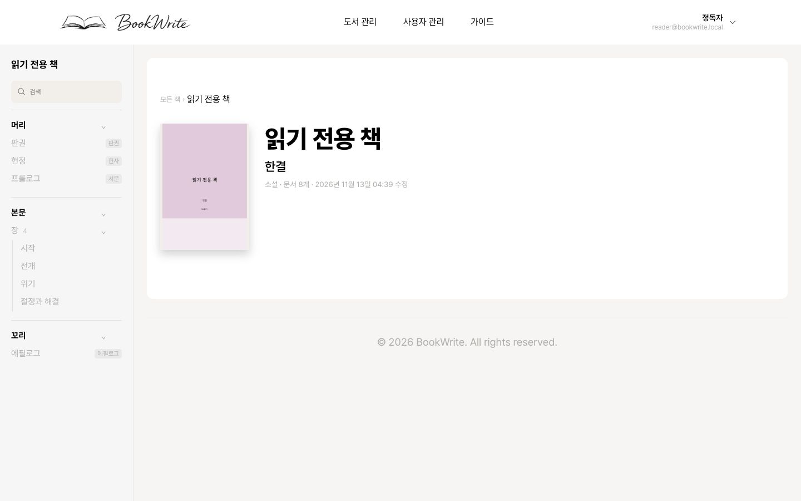
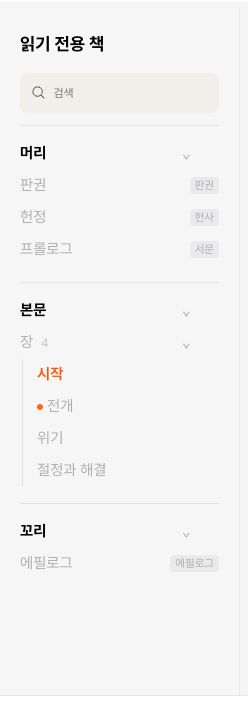
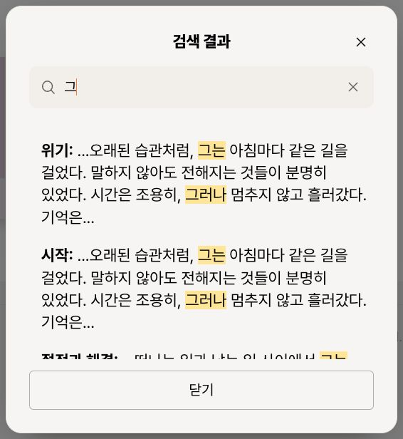
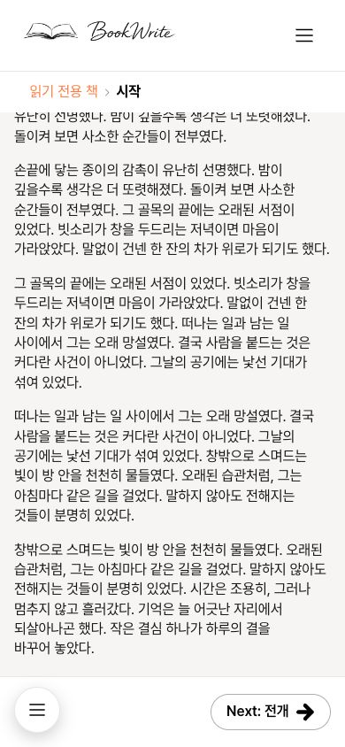

## 읽기

읽기 권한만 있는 책은 고칠 수 없고 읽기만 합니다. 읽기 권한은 책의 **책 설정 › 권한 설정** 에서 줍니다. **전체 사용자 읽기 허용** 을 켜면 로그인한 모든 사용자가, 개별 사용자의 **읽기** 를 고르면 그 사람이 읽을 수 있습니다([역할과 초대](/10/bookwrite/111/-)). 웹에 공개된 책은 로그인하지 않은 방문자도 읽습니다([웹에 공개하기](/10/bookwrite/131/-)).

## 책 열기

**도서 관리** 에 읽을 수 있는 책이 모두 나옵니다. 표지를 누르면 책의 첫 화면이 열립니다. 첫 화면에는 표지와 제목, 부제, 지은이, 그리고 책의 종류와 문서 수, 마지막으로 고친 때가 나옵니다.

읽는 사람에게는 **내용 편집** , **표지 편집** 같은 탭과 **인쇄** 카드가 나오지 않습니다. 이것들은 쓰기 권한이 있는 사람에게만 보입니다.

## 목차

왼쪽 목차에 책의 문서가 **머리** , **본문** , **꼬리** 로 나뉘어 나옵니다. 파트가 있는 책은 파트 아래에 그 파트의 장이 들어 있습니다. 같은 종류의 문서가 둘 이상이면 "장 4"처럼 한 줄로 묶이고, 그 아래에 문서들이 들어 있습니다. 다른 문서 옆에는 **판권** , **서문** 처럼 문서 종류가 작게 적힙니다. 무리 이름이나 파트, 묶음 옆의 화살표를 누르면 접고 펼칩니다.

문서 제목을 누르면 그 문서를 읽습니다. 쓰는 사람의 목차와 같지만 **+** (추가)와 **⋯** (이름 바꾸기, 삭제)가 없고, 끌어서 순서를 바꿀 수도 없습니다. 표지 무리도 나오지 않습니다.

마지막으로 읽던 문서에는 제목 앞에 작은 점이 찍힙니다. 다음에 책을 열면 어디까지 읽었는지 알 수 있습니다(이 브라우저에 기억합니다).

## 읽고 넘기기

문서 위쪽에는 책 제목과 문서 제목이 나옵니다. 책 제목을 누르면 책의 첫 화면으로 돌아갑니다.

문서 끝의 **Next: 다음 문서 제목** 단추를 누르면 다음 문서로 넘어갑니다. 키보드가 있으면 `→` 키로도 넘어갑니다. 앞 문서로는 목차나 브라우저의 뒤로 가기로 갑니다.

## 검색

목차 맨 위의 **검색** 칸에 찾을 말을 쓰고 Enter를 누르면 **검색 결과** 창이 열립니다. 창 안의 검색 칸에서 다시 찾을 수도 있고, 키보드의 `Ctrl` + `Space`로 창을 바로 열 수도 있습니다.

결과마다 문서 제목과 찾은 말이 든 대목이 나오고, 찾은 말은 색으로 표시됩니다. 결과를 누르면 그 문서가 열립니다.

## 휴대폰에서 읽기

휴대폰처럼 화면이 좁으면 문서가 화면을 채우고 목차는 숨겨집니다. 왼쪽 아래의 둥근 ☰ 단추를 누르면 목차가 옆에서 열립니다. 문서를 누르면 그 문서가 열리면서 목차가 닫히고, 목차 바깥을 눌러도 닫힙니다. 문서를 읽는 중에는 문서 끝의 **Next** 단추로 이어서 읽습니다.

위쪽 메뉴( **도서 관리** , **가이드** 등)도 오른쪽 위의 ☰ 단추 안으로 들어갑니다.

