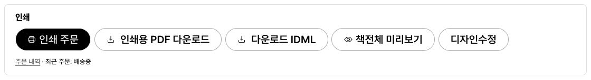
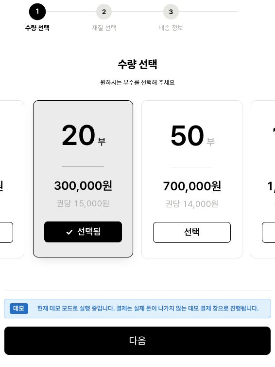
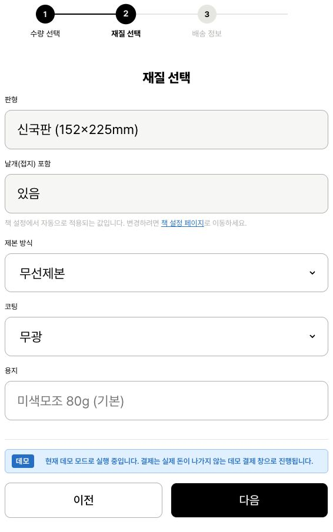
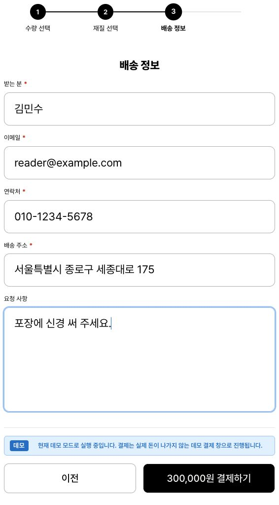
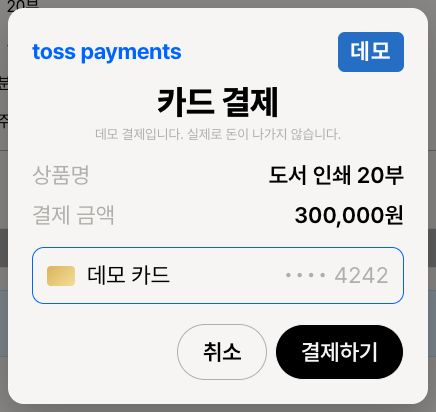
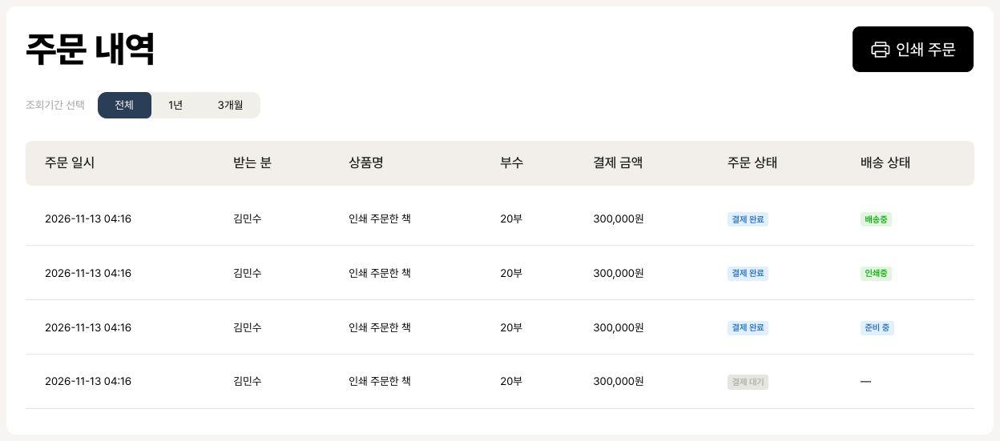
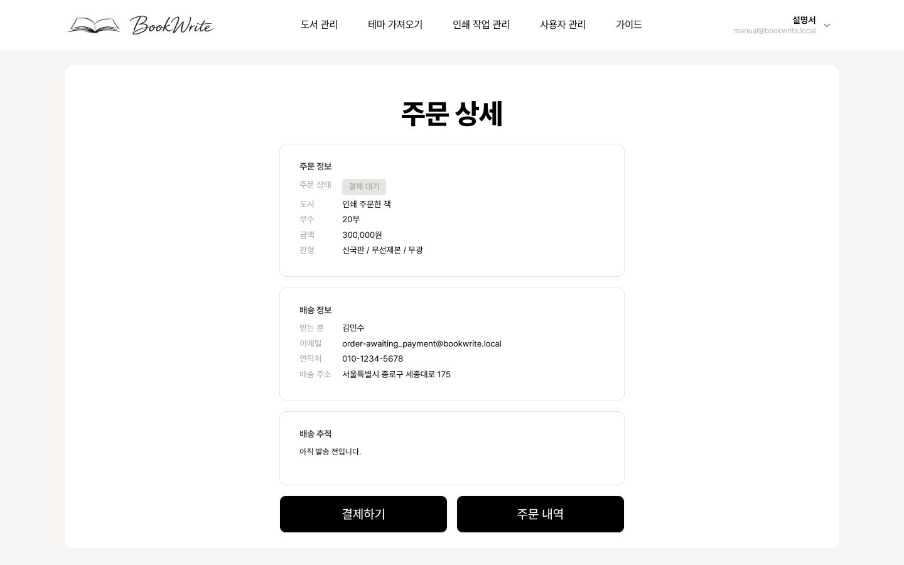

## 인쇄 주문

다 쓴 책을 종이책으로 주문할 수 있습니다. 주문하고 결제하면 BookWrite가 인쇄용 내지와 표지 파일을 만들어 인쇄소로 보냅니다. 파일을 미리 만들어 둘 필요는 없습니다. 주문하기 전에 [책 미리보기](/10/bookwrite/127/-)로 책 전체를 한 번 훑어보세요.

쓰기 권한이 있는 사람만 주문할 수 있습니다.

## 인쇄 파일만 내려받기

**인쇄** 카드의 **인쇄용 PDF 다운로드** 를 누르면 주문할 때 인쇄소로 보내는 두 파일, 본문(`inner_book.pdf`)과 표지(`book_cover.pdf`)를 zip 파일 하나로 내려받습니다. 누를 때마다 새로 만들기 때문에 책 분량에 따라 잠시 걸립니다. 표지의 책등 두께는 표지에 정한 용지를 따릅니다. 주문할 때는 주문에서 고른 용지를 따릅니다.

## 주문하기

책의 첫 화면(개요)에 있는 **인쇄** 카드에서 **인쇄 주문** 을 누릅니다. **주문 정보** 화면이 열리고, 세 단계를 **다음** 과 **이전** 으로 오갑니다.

### 1. 수량 선택

원하는 부수의 카드를 누릅니다. 카드마다 값과 권당 값이 나옵니다.

| 부수 | 값 | 권당 |
| --- | --- | --- |
| 2부 | 100,000원 | 50,000원 |
| 20부 | 300,000원 | 15,000원 |
| 50부 | 700,000원 | 14,000원 |
| 100부 | 1,000,000원 | 10,000원 |

값은 인쇄소가 정한 상품 값이고, 결제할 때도 이 값으로 계산합니다.

### 2. 재질 선택

- **판형** 과 **날개(접지) 포함** — 책 설정에서 정한 값이 나오고, 여기서는 바꿀 수 없습니다. 바꾸려면 아래의 **책 설정 페이지** 링크로 가서 **레이아웃 설정** 에서 고칩니다([표지](/10/bookwrite/124/-)).
- **제본 방식** — **무선제본** 또는 **중철제본**.
- **코팅** — 표지의 **무광** 또는 **유광**.
- **용지** — 칸에 흐리게 적힌 "미색모조 80g (기본)"은 안내 문구일 뿐입니다. 비워 두면 표지의 **용지** 설정(책 설정 › 레이아웃 설정)을 그대로 씁니다. `미색모조 100g`처럼 무게를 적으면, 이 주문의 표지는 책등 너비를 그 용지 두께로 계산합니다.

### 3. 배송 정보

**받는 분** , **이메일** , **연락처** (010-xxxx-xxxx), **배송 주소** 를 적습니다. 처음에는 내 이름과 이메일이 들어 있습니다. 배송이나 인쇄에 대해 알릴 것이 있으면 **요청 사항** 에 적습니다(선택).

마지막 단계의 단추에는 고른 부수의 값이 적힙니다(예: **300,000원 결제하기** ). 누르면 주문이 저장되고 **결제** 화면으로 넘어갑니다.

## 결제

**결제** 화면에 도서, 부수, 판형·제본·코팅, 받는 분, 배송 주소와 결제할 금액이 나옵니다. 금액이 적힌 결제 단추를 누르면 결제 창이 열립니다. 결제는 토스페이먼츠로 합니다.

결제가 끝나면 **결제가 완료되었습니다** 화면에 결제 금액, 주문번호, 결제 수단, 승인 시각이 나옵니다. **주문 확인** 을 누르면 주문 상세로 갑니다.

결제 창을 닫으면 주문은 **결제 대기** 로 남습니다. 결제 승인에 실패하면 **결제에 실패했습니다** 화면이 나오고 주문은 **결제 실패** 가 됩니다. 어느 쪽이든 **다시 시도** 를 누르거나 나중에 주문 상세에서 다시 결제하면 됩니다.

### 데모 모드

인쇄소가 데모 모드로 운영 중이면 주문 정보 화면 아래에 **데모** 표시와 함께 "현재 데모 모드로 실행 중입니다…"가 나옵니다. 이때 결제 단추는 토스 결제 창 대신 **데모 결제 창** 을 엽니다. 창에는 상품명과 결제 금액, 데모 카드가 나옵니다.

- **결제하기** — 돈은 나가지 않고 결제가 끝난 것으로 처리됩니다. 그 뒤는 실제 주문과 같습니다. 파일을 만들어 인쇄소로 보냅니다.
- **취소** (또는 Esc) — 결제를 취소합니다. 주문은 결제 대기로 남습니다.

## 주문 뒤에 일어나는 일

결제가 끝나면 다음이 차례로 진행됩니다.

1. **PDF 생성중** — 인쇄용 내지와 표지(재단 여백과 재단선 포함)를 만듭니다. 책이 길면 몇 분 걸립니다.
2. **인쇄소 접수** — 두 파일이 붙은 인쇄 작업이 인쇄소에 생깁니다([인쇄소](/10/bookwrite/133/-)).
3. **인쇄중** , **배송중** , **배송 완료** — 인쇄소에서 작업을 진행하면 주문 상태도 따라 바뀝니다.

파일을 만들지 못하면 주문이 **인쇄 준비 실패** 로 바뀝니다. 결제는 **결제 완료** 그대로이니 다시 결제할 필요가 없습니다. 주문 상세에 "결제는 그대로 유지되며, 인쇄 파일은 다시 만들어집니다."라는 안내와 **다시 시도** 단추가 나오며(주문한 사람과 관리자에게), 누르면 인쇄 파일을 다시 만들어 인쇄소로 보냅니다.

## 주문 내역과 주문 상세

인쇄 카드의 **주문 내역** 을 누르면 이 책의 주문이 모두 나옵니다. 카드에는 가장 최근 주문의 상태도 나옵니다(예: **최근 주문: 준비 중** ). **조회기간 선택** 에서 **전체** , **1년** , **3개월** 로 좁힐 수 있습니다.

표에는 주문 일시, 받는 분, 상품명, 부수, 결제 금액, **주문 상태** (결제 대기, 결제 실패, 결제 완료)와 **배송 상태** (준비 중, 인쇄중, 배송중, 배송 완료)가 나옵니다. 주문 일시를 누르면 **주문 상세** 가 열립니다.

주문 상세에는 주문 정보(주문 상태, 도서, 부수, 금액, 판형·제본·코팅), 배송 정보, 배송 추적이 나옵니다. 배송 추적에는 인쇄소가 송장번호를 넣기 전까지 "아직 발송 전입니다."가 나오고, 넣은 뒤에는 택배사, 송장번호(조회 링크), 발송·배송 완료 시각이 나옵니다. 진행 중인 주문은 10초마다 저절로 새로 고쳐집니다. 아직 결제하지 않은 주문에는 **결제하기** 단추가 있어, 누르면 결제 화면으로 갑니다.

