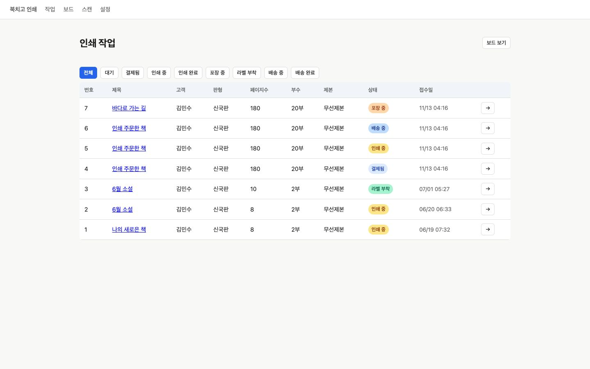
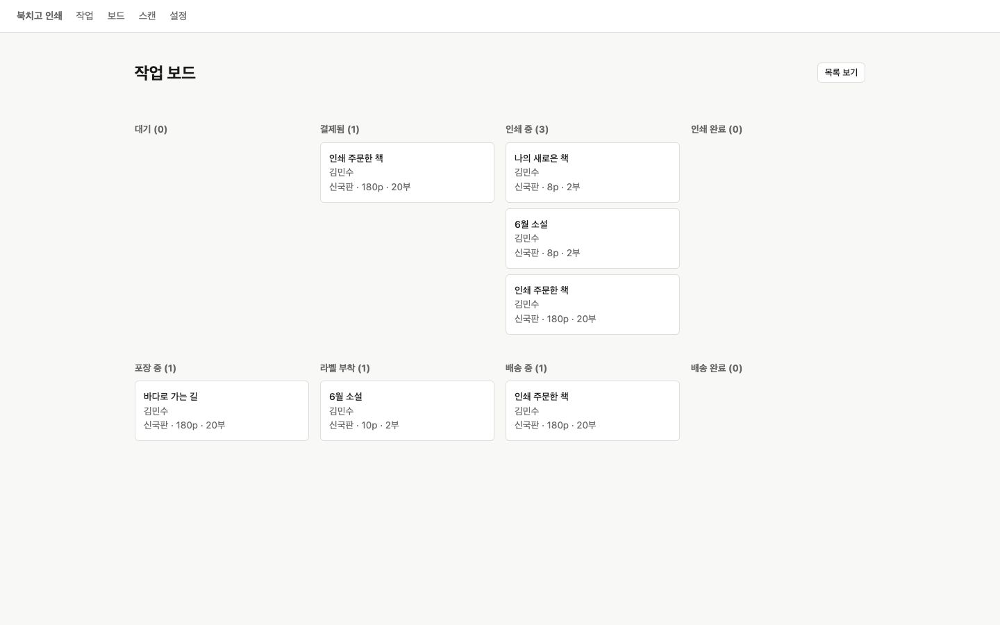
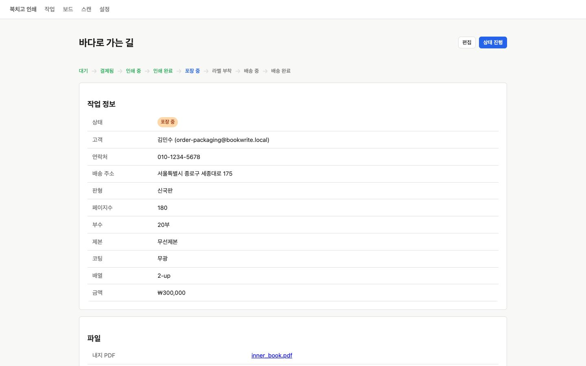
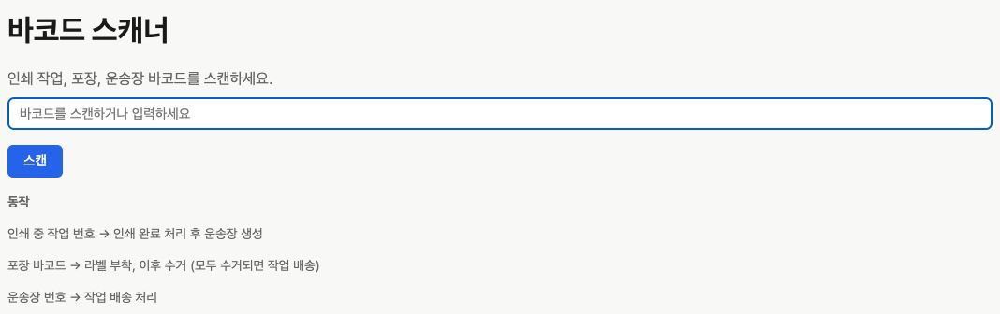
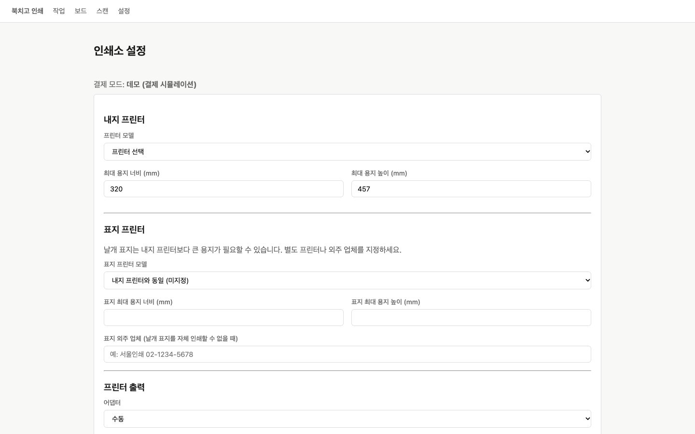

## 인쇄소 (인쇄 담당자용)

[인쇄 주문](/10/bookwrite/132/-)이 결제되면 인쇄소에 인쇄 작업이 생깁니다. 인쇄 담당자는 인쇄소 화면에서 작업을 받아 인쇄하고, 포장해서 보냅니다.

## 인쇄소 열기

인쇄소는 역할이 **인쇄** 나 **관리자** 인 사용자만 엽니다. 관리자가 **사용자 관리** 에서 역할을 바꿔 줍니다([역할과 초대](/10/bookwrite/111/-)).

이 역할이면 위쪽 메뉴에 **인쇄 작업 관리** 가 나옵니다. 누르면 인쇄소 화면이 열리고, 위쪽 막대에 **작업** , **보드** , **스캔** , **설정** 이 있습니다. 인쇄소 화면에는 BookWrite로 돌아가는 메뉴가 없으니, 브라우저의 뒤로 가기나 BookWrite 주소로 돌아갑니다.

## 작업의 흐름

작업은 다음 상태를 차례로 지납니다.

**대기** → **결제됨** → **인쇄 중** → **인쇄 완료** → **포장 중** → **라벨 부착** → **배송 중** → **배송 완료**

- 결제된 주문의 작업은 **결제됨** 으로 들어오고, 곧 **설정** 의 **어댑터** 에 따라 프린터로 보내져 **인쇄 중** 이 됩니다.
- **인쇄 완료** 가 되면 운송장과 **작업 라벨** 을 만들고 **포장 중** 으로 넘어갑니다.
- 주문한 사람의 주문 상태도 따라 바뀝니다. 작업이 들어오면 **인쇄소 접수** , 인쇄와 포장 동안은 **인쇄중** , 라벨을 붙이면 **배송중** , 다 받으면 **배송 완료** 입니다.

## 작업

**작업** 에는 들어온 차례대로 작업이 나옵니다. 번호, 제목, 고객, 판형, 페이지수, 부수, 제본, 상태, 접수일이 나오고, 위의 단추( **전체** , **대기** , **결제됨** …)로 상태별로 거를 수 있습니다. 줄 끝의 \*\*→\*\*를 누르면 그 작업을 다음 상태로 넘깁니다. **보드 보기** 를 누르면 보드로 바꿉니다. 휴대폰처럼 화면이 좁으면 표가 화면보다 넓어지므로, 표를 옆으로 밀어 나머지 칸을 봅니다.

## 보드

**보드** 는 상태마다 칸이 하나씩 있고, 칸에 그 상태의 작업 카드가 놓입니다. 칸 이름 옆에 작업 수가 나옵니다. 지금 어디에 일이 몰려 있는지 한눈에 볼 때 씁니다.

## 작업 상세

작업 제목을 누르면 상세가 열립니다.

- 맨 위에 상태의 흐름이 나오고, 지난 상태와 지금 상태가 표시됩니다.
- **작업 정보** — 고객, 연락처, 배송 주소, 판형, 쪽수, 부수, 제본, 코팅, 가격, 요청 사항.
- **파일** — **내지 PDF** 와 **표지 PDF** 를 내려받습니다. 인쇄 완료 뒤에는 **작업 라벨** 의 **라벨 다운로드** 도 있습니다.
- **배송** , **포장** — 운송장이 생기면 운송장 번호, 택배사, 포장 상자와 바코드가 나옵니다.
- **진행 단계** — 상태마다 넘어간 시각.

**상태 진행** 은 작업을 다음 상태로 넘깁니다. **편집** 에서는 고객 정보나 사양을 고칩니다(주문을 바꾸지는 않습니다).

## 스캔

**스캔** 은 바코드 스캐너로 작업을 넘기는 화면입니다. 칸에 바코드를 찍으면(스캐너가 입력하고 Enter를 누릅니다) 바로 처리하고 그 작업의 상세로 갑니다. 손으로 적고 **스캔** 을 눌러도 됩니다.

- **작업 번호** — 인쇄 중인 작업이면 인쇄 완료로 바꾸고 운송장을 만듭니다. 다른 상태면 다음 상태로 넘깁니다.
- **포장 바코드** — 처음 찍으면 라벨 부착, 다시 찍으면 수거됨입니다. 작업의 상자가 모두 수거되면 작업이 배송 중이 됩니다.
- **운송장 번호** — 작업을 배송 중으로 바꿉니다.

## 설정

**인쇄소 설정** 에서 인쇄소의 장비를 정하고 **저장** 합니다.

- **결제 모드** — **데모 (결제 시뮬레이션)** 또는 **실 결제**. 여기서는 보기만 하고, 서버 관리자가 바꿉니다(`bin/rails print:payments_on` / `print:payments_off`). 데모 모드에서는 주문이 데모 결제 창으로 결제됩니다.
- **내지 프린터** — 프린터 모델을 고르면 최대 용지 너비·높이(mm)가 채워집니다. 직접 고쳐도 됩니다.
- **표지 프린터** — 날개 표지는 내지 프린터보다 큰 용지가 필요할 수 있습니다. 따로 프린터를 고르거나, 자체 인쇄할 수 없을 때 맡길 **표지 외주 업체** 를 적습니다.
- **프린터 출력** — 결제된 작업을 프린터로 보내는 방법( **어댑터** )입니다.
  - **수동** — 파일을 보내지 않고 작업을 인쇄 중으로만 바꿉니다. 담당자가 작업 상세에서 PDF를 내려받아 인쇄합니다.
  - **핫 폴더** — 내지 PDF와 표지 PDF를 **핫 폴더 — 내지 경로** , **핫 폴더 — 표지 경로** 에 복사합니다. 프린터의 RIP가 그 폴더를 지켜보다가 인쇄합니다. 판 배열(임포지션)도 RIP가 합니다.
  - **IPP** — 아직 준비 중입니다. 고르지 마세요.

