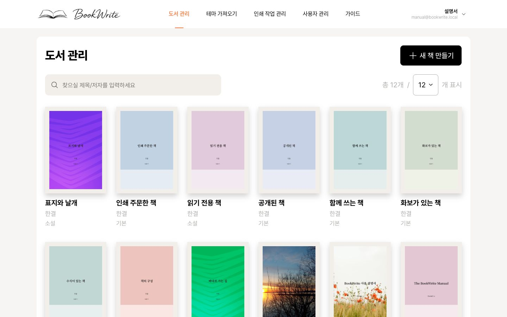

## BookWrite에 오신 것을 환영합니다

BookWrite는 원고를 쓰고, 책 모양으로 조판하고, 종이책으로 인쇄 주문하거나 웹에 공개하는 데까지 한곳에서 할 수 있는 책 만들기 도구입니다.

소설, 자서전, 시집, 에세이, 설명서(지금 읽고 계신 이 책처럼), 사내 안내서까지 무엇이든 만들 수 있습니다. 직접 운영하는 서버에 설치해 쓰므로 원고와 데이터는 모두 여러분의 것이고, 책이나 사용자 수에도 제한이 없습니다.

## 할 수 있는 일

- **글쓰기** — 편집기에서 바로 쓰거나 마크다운으로 씁니다. 이미지, 표, 수식도 넣을 수 있습니다.
- **책의 구조** — 장, 파트, 서문·헌사·추천사 같은 앞붙이와 부록·에필로그를 왼쪽 목차에서 추가하고 끌어서 순서를 바꿉니다.
- **조판과 교정** — 쓴 글이 실제 책 쪽으로 조판되어 보입니다. 교정/교열 화면에서 펼친 면을 보며 고칩니다.
- **디자인** — 디자인 테마를 고르면 판형도 그 디자인을 따릅니다. 디자인수정에서 글꼴, 여백, 머리글·바닥글, 표, 표지 글자를 책마다 다듬습니다.
- **표지** — 앞표지, 뒤표지, 책등, 날개를 만들고 인쇄용 표지 PDF와 인디자인(IDML) 파일을 받습니다.
- **원고 불러오기와 내보내기** — Word, 한글(HWPX), 마크다운 원고를 불러오고 내보냅니다.
- **인쇄 주문** — 만든 책을 종이책으로 주문하고 진행 상황을 확인합니다. 인쇄소에 보내는 본문·표지 PDF를 직접 내려받을 수도 있습니다.
- **웹 공개** — 책을 웹에 공개하고 링크나 QR 코드로 나눕니다.

## 휴대폰에서

BookWrite는 휴대폰처럼 좁은 화면에서도 씁니다. 화면이 좁으면 상단 메뉴가 오른쪽 위의 ☰ 단추 안으로 들어가고, 책 안에서는 왼쪽 아래의 둥근 ☰ 단추를 눌러 **목차** 를 엽니다. 글쓰기 화면은 편집기 아래에 페이지 미리보기가 놓이고, 책전체 미리보기는 한 쪽씩 넘깁니다.

## 이 설명서의 순서

1. 처음에는 [역할과 초대](/10/bookwrite/111/-), [새 책 만들기](/10/bookwrite/112/-), [책 작업 공간: 목차와 개요](/10/bookwrite/113/-)를 읽어 보세요.
2. 글을 쓸 때는 [문서 종류](/10/bookwrite/114/-)와 [글쓰기](/10/bookwrite/115/-)를 참고하세요.
3. 책의 모양은 [교정/교열](/10/bookwrite/121/-), [디자인수정](/10/bookwrite/122/-), [표지](/10/bookwrite/124/-)에서 다룹니다.
4. 마지막으로 [책 미리보기](/10/bookwrite/127/-), [인쇄 주문](/10/bookwrite/132/-), [웹에 공개하기](/10/bookwrite/131/-)로 책을 완성합니다.

막히는 곳이 있으면 [도움말](/10/bookwrite/136/-)을 보세요. 여러분이 만들 책이 기대됩니다!