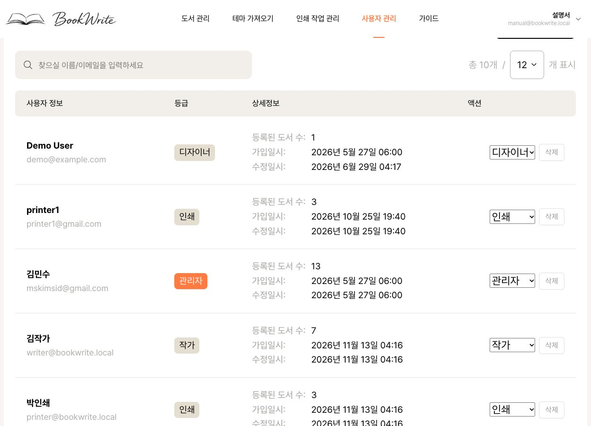
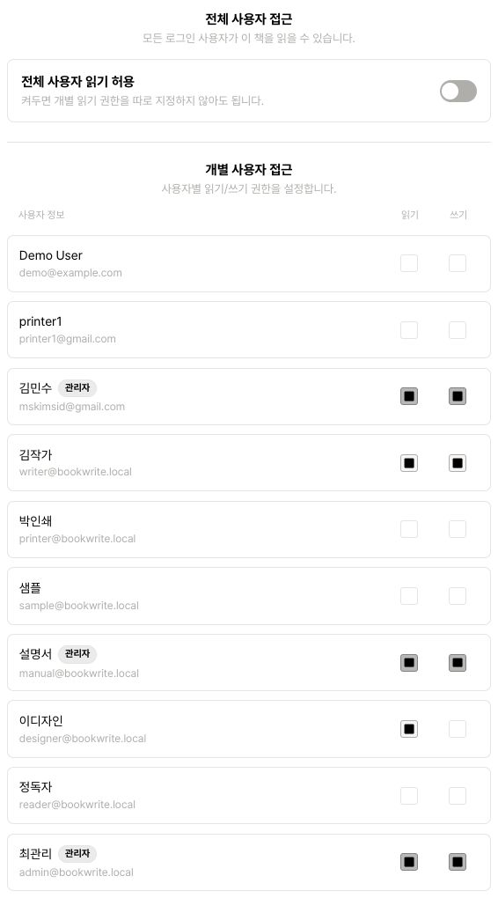

## 역할과 초대

BookWrite는 혼자 써도 되고, 여러 사람을 초대해 함께 써도 됩니다. 사람마다 **역할** 이 있고, 책마다 누가 읽고 쓸 수 있는지 **권한** 을 정합니다.

## 역할

가입한 사람은 모두 책을 만들고 쓸 수 있습니다. 역할에 따라 상단 메뉴에 보이는 항목이 달라집니다.

| 역할 | 할 수 있는 일 |
| --- | --- |
| **작가** | 책을 만들고 쓰고, 인쇄를 주문합니다. 새로 가입한 사람은 모두 작가입니다. |
| **디자이너** | 작가가 하는 일에 더해, 상단 메뉴의 **테마 가져오기** 로 디자인 테마를 들여옵니다. |
| **인쇄** | 작가가 하는 일에 더해, 상단 메뉴의 **인쇄 작업 관리** 에서 인쇄소 일을 합니다. |
| **관리자** | 모든 일을 할 수 있고, 사람들의 역할을 바꾸거나 계정에서 제거하고, 참여 링크를 새로 만듭니다. 관리자는 열어 볼 수 있는 책이면 모두 편집할 수 있습니다. |

BookWrite를 처음 설치하고 가입한 사람이 관리자가 됩니다.

디자이너와 인쇄 담당자의 일은 [테마 가져오기 (디자이너용)](/10/bookwrite/134/-)와 [인쇄소 (인쇄 담당자용)](/10/bookwrite/133/-)에서 설명합니다.

## 사람 초대하기

1. 상단 메뉴에서 **사용자 관리** 를 누릅니다.
2. **사용자 초대** 버튼을 누르면 참여 링크와 QR 코드가 나옵니다.
3. 링크를 누르면 복사됩니다. 메일이나 메신저에 붙여 넣거나, **공유하기** 로 바로 보내세요. 휴대폰으로는 QR 코드를 찍으면 됩니다.

링크를 받은 사람은 **회원가입** 화면에서 이름, 이메일, 비밀번호를 입력하고 **가입하기** 를 누르면 바로 로그인됩니다. 로그인 화면 아래의 **회원가입** 링크도 같은 곳으로 갑니다.

> **참고** : 참여 링크를 아는 사람은 누구나 가입할 수 있습니다. 링크가 엉뚱한 곳에 퍼졌다면, 관리자가 **사용자 초대** 창에서 링크 옆의 새로 고침 버튼( **참여 링크 재생성** )을 누르세요. 예전 링크는 더 이상 쓸 수 없습니다.

## 사용자 관리

**사용자 관리** 화면에는 가입한 사람이 모두 나옵니다. 이름이나 이메일로 찾을 수 있고, 이름을 누르면 그 사람의 프로필(등급, 등록된 도서, 마지막 접속일시)이 열립니다.

관리자에게는 각 사람 옆에 두 가지가 더 보입니다.

- **등급** 선택 상자 — 작가, 디자이너, 인쇄, 관리자 중에서 고르면 바로 바뀝니다.
- **사용자 제거** 버튼 — 확인 창에서 **삭제** 를 누르면 그 사람은 더 이상 로그인할 수 없습니다.

자기 자신의 역할은 바꾸거나 제거할 수 없습니다.

## 책마다 권한 정하기

책을 만든 사람은 그 책의 읽기·쓰기 권한을 가집니다. 다른 사람에게 권한을 주려면 책에서 **책 설정** › **권한 설정** 으로 갑니다.

- **전체 사용자 읽기 허용** — 켜면 지금 가입해 있는 모든 사람이 이 책을 읽을 수 있습니다. 사내 안내서처럼 모두가 봐야 하는 책에 좋습니다. 이 책은 나중에 가입하는 사람에게도 그 사람 몫의 사본으로 하나씩 만들어집니다.
- **개별 사용자 접근** — 사람마다 **읽기** 와 **쓰기** 를 체크합니다. 쓰기를 체크하면 읽기도 함께 체크됩니다.

다 고쳤으면 화면 아래의 **설정 저장** 을 누르세요.

### 읽기와 쓰기

- **읽기** 권한이 있는 사람은 책을 읽기만 합니다. 목차의 `+`·`⋯` 메뉴와 책 편집 탭이 보이지 않습니다. 자세한 내용은 [읽기](/10/bookwrite/130/-)를 보세요.
- **쓰기** 권한이 있는 사람은 내용, 표지, 설정 등 책의 모든 것을 고칠 수 있습니다.

로그인하지 않은 사람에게도 책을 보여 주려면 웹에 공개하세요. [웹에 공개하기](/10/bookwrite/131/-)에서 설명합니다.