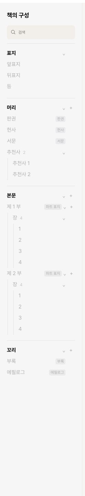

## 문서 종류

책은 여러 **문서** 로 이루어집니다. 문서마다 종류가 있고, 종류에 따라 목차의 어느 묶음에 들어가는지와 책에 어떻게 조판되는지가 정해집니다. 문서를 추가하는 방법은 [책 작업 공간: 목차와 개요](/10/bookwrite/113/-)를 보세요.

## 본문

| 종류 | 설명 |
| --- | --- |
| **장** | 책의 본문입니다. 길이 제한 없이 쓸 수 있고, 첫 글자를 크게 하는 드롭캡이 기본으로 켜져 있습니다. 본문의 `+` › **장 추가** 로 넣습니다. |
| **시** | 시집의 본문입니다. 시집에서 **장 추가** 를 누르면 시가 추가됩니다. |
| **파트 표지** | 여러 장을 한 부로 묶는 표지 쪽입니다(예: 제 1 부). 책 구조 설정에서 **다중 파트 구성** 을 켜면 본문의 `+`에 **파트 추가** 가 생깁니다. 그 뒤에 오는 장들이 이 파트에 속합니다. |
| **화보** | 사진 여러 장을 차례로 싣는 문서입니다. 글 대신 사진과 설명, 쪽 배치를 정합니다. [화보](/10/bookwrite/120/-)를 보세요. |

**장 표지** 는 따로 만드는 문서가 아닙니다. 책 구조 설정에서 **장 표지** 를 켜면 장과 시마다 그 제목을 담은 표지 쪽이 앞에 자동으로 들어갑니다.

## 머리 (본문 앞)

| 종류 | 설명 |
| --- | --- |
| **헌사** | 책을 바치는 짧은 글입니다. 한 권에 하나입니다. |
| **서문** | 머리말, 프롤로그입니다. 한 권에 하나입니다. |
| **추천사** | 다른 사람이 써 준 추천의 글입니다. 여러 개를 넣을 수 있고, 추천사 1, 추천사 2처럼 이름이 붙습니다. 둘 이상이면 목차에서 **추천사** 한 줄 아래에 모입니다. |
| **감사의 글** | 고마운 분들께 드리는 글입니다. 한 권에 하나입니다. |
| **일러두기** | 책을 읽는 방법이나 표기 원칙을 알리는 글입니다. 불러온 원고에 "일러두기" 제목이 있으면 이 종류로 들어옵니다. |
| **판권** | 지은이, 발행처, ISBN 등을 적는 쪽입니다. 책을 만들 때 자동으로 생기며, 글을 직접 고칠 수 있습니다. |

헌사, 서문, 추천사, 감사의 글은 머리의 `+`로 넣거나, **책 설정** › **책 구조 설정** 의 스위치를 켜서 넣습니다. 스위치를 끄면 비어 있는 문서는 지워지고, 글이 있는 문서는 남습니다.

판권은 **판권을 책 뒤에 배치** 를 켜면 꼬리로 옮겨 갑니다.

## 꼬리 (본문 뒤)

| 종류 | 설명 |
| --- | --- |
| **부록** | 본문을 보충하는 자료입니다. |
| **에필로그** | 맺음말입니다. |

둘 다 꼬리의 `+`로 넣습니다.

## 목차에 보이지 않는 쪽

**표제지** , **속표지** , **빈 페이지** 는 책을 만들 때 함께 생기지만 목차에는 나오지 않습니다. 내용은 책 정보로 자동으로 채워집니다. [자동으로 만드는 쪽](/10/bookwrite/123/-)을 보세요.

