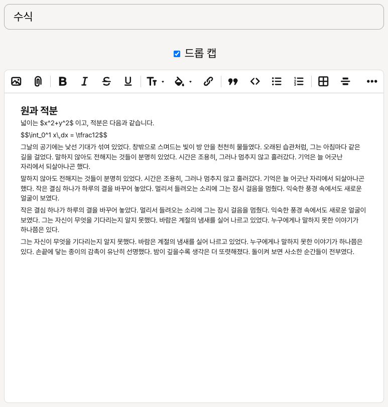
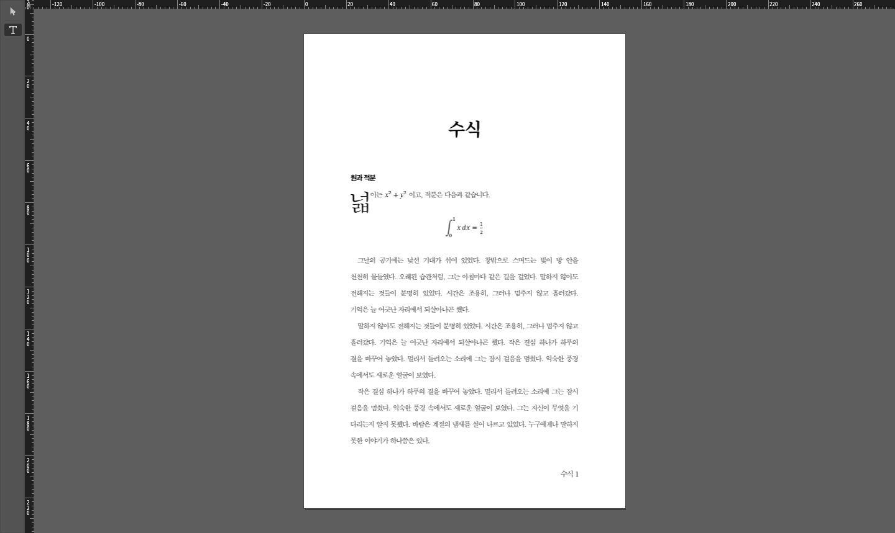
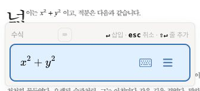

## 수식

본문에 LaTeX로 수식을 쓰면, 책을 조판할 때 수식으로 짜여 들어갑니다.

## 수식 쓰기

글쓰기 화면에서 수식을 `$`로 감싸 씁니다.

- **글 안의 수식** — 문장 안에 `$…$`로 씁니다.
- **따로 세우는 수식** — `$$…$$`만 있는 문단을 만듭니다. 그 문단 전체가 수식이어야 합니다.

```
넓이는 $\pi r^2$이고, 근의 공식은 다음과 같습니다.

$$x = \frac{-b \pm \sqrt{b^2 - 4ac}}{2a}$$
```

이런 것은 수식으로 보지 않습니다.

- 여는 달러 기호 바로 뒤나 닫는 달러 기호 바로 앞에 빈칸이 있을 때
- 닫는 달러 기호 바로 뒤에 숫자가 올 때. 그래서 "$5와 $10"은 돈으로 남습니다.
- 앞에 역슬래시를 붙인 달러 기호 (`\$`)



## 어디에서 수식으로 보이나

수식은 XeLaTeX로 조판합니다. 책전체 미리보기, 인쇄, 교정/교열에서 수식으로 보입니다. 웹에서 책을 읽을 때와 글쓰기 화면에서는 LaTeX 글 그대로 보입니다.



수식이 LaTeX 글 그대로 인쇄될 때가 있습니다.

- **서버에 XeLaTeX나 `pdfseparate`가 없을 때** — 수식에는 둘 다 필요합니다. 하나라도 없으면 모든 수식이 LaTeX 글로 남습니다. 서버 관리자에게 문의하세요.
- **수식에 오류가 있을 때** — 그 수식만 LaTeX 글로 남습니다.
- **괄호 짝이 맞지 않을 때** — `{`나 `}` 하나가 빠지면 그 장의 수식이 **모두** LaTeX 글로 남을 수 있습니다. 장 전체의 수식이 조판되지 않았다면 먼저 중괄호 짝을 확인하세요.
- **제목과 표 안의 수식** — 수식으로 짜지 않고 LaTeX 글 그대로 나옵니다.

수식 안의 `\text{…}`에는 한글을 써도 되고, 책의 본문 글꼴로 짜입니다.

## 교정/교열에서 수식 고치기

[교정/교열](/10/bookwrite/121/-) 화면에서 조판된 수식을 누르면 그 수식 위에 **수식** 패널이 열리고, 수식의 LaTeX가 들어 있습니다.

- `Enter` — 고친 수식을 저장합니다. 그 수식만 글에 저장되고 쪽을 다시 배치합니다.
- `Esc` — 아무것도 바꾸지 않고 닫습니다.
- `Shift+Enter` — 수식 안에서 줄을 바꿉니다.
- **⌨** 단추 — 화면 키보드를 엽니다.

패널 밖, 쪽의 다른 곳을 눌러도 고친 수식이 저장됩니다. 칸을 비우면 아무것도 바꾸지 않습니다.



수식 옆 글자의 오탈자는 교정/교열의 글자 도구로 바로 고칠 수 있습니다. 하지만 수식을 새로 넣거나 지우는 일, 수식이 아닌 글로 바꾸는 일은 **글쓰기** 에서 합니다. 교정/교열에서 그런 수정을 하면 "이 부분은 글쓰기에서 고쳐 주세요" 또는 "이 수식은 글쓰기에서 고쳐 주세요"라고 알려 주고 저장하지 않습니다.

수식을 눌러 고치는 것은 수식이 조판되어 있을 때만 됩니다. 서버에 XeLaTeX가 없으면 수식은 글자로 보이고, 글쓰기에서 고칩니다.