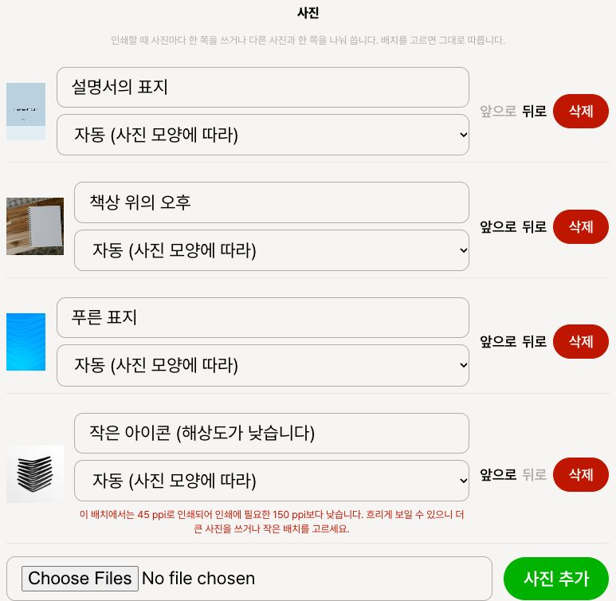

## 화보

**화보** 는 사진만으로 이루어진 장입니다. 본문 글 대신 사진 목록이 있고, 사진마다 설명과 배치를 정합니다. 인쇄에서는 고른 배치대로 사진이 쪽에 놓입니다.

화보는 목차의 **본문**  **+** 메뉴(또는 파트의 **+** 메뉴)에서 **화보 추가** 를 눌러 만듭니다. 새 화보가 만들어지면 바로 이 화면이 열립니다.

## 화보 편집 화면

목차에서 화보를 누르면 편집 화면이 열립니다. 제목 칸 아래에 **사진** 목록이 있습니다.

사진마다 다음이 있습니다.

- **설명** — 사진 아래에 들어갈 글입니다.
- **배치** — 인쇄에서 이 사진이 놓일 방식입니다. 아래를 보세요.
- **앞으로** / **뒤로** — 사진 순서를 바꿉니다.
- **삭제** — 사진을 뺍니다.

설명과 배치는 바꾸면 바로 저장됩니다. 제목은 위쪽 막대의 **저장** 단추나 자동 저장으로 저장됩니다. 오른쪽 이미지 레이아웃 설정 패널은 화보에서는 쓰지 않고, 화보에는 페이지 미리보기도 없습니다.

## 사진 추가

목록 아래에서 사진 파일을 고르고 **사진 추가** 를 누릅니다. 여러 장을 한꺼번에 고를 수 있습니다. PNG, JPEG, WebP 파일을 쓸 수 있습니다. 새 사진은 목록 끝에 붙습니다.

## 배치

| 배치 | 인쇄에서 |
| --- | --- |
| **자동 (사진 모양에 따라)** | 세로 사진과 정사각형 사진은 한 쪽에 한 장, 가로 사진은 한 쪽에 두 장씩 |
| **한 쪽 가득 (재단선까지)** | 사진 한 장이 쪽을 가득 채우고 종이 끝까지 나감. 설명 없음 |
| **한 쪽에 한 장** | 여백 안에 한 장, 아래에 설명 |
| **한 쪽에 두 장** | 위아래로 두 장, 각각 설명 |
| **한 쪽에 네 장** | 2×2로 네 장까지, 각각 설명 |
| **두 쪽에 걸쳐** | 펼친 두 쪽에 걸쳐 한 장, 종이 끝까지. 설명 없음 |

- **한 쪽에 두 장** 은 이어진 두 장이 짝이 됩니다. 짝이 없으면 한 쪽에 한 장으로 놓입니다.
- **한 쪽에 네 장** 은 이 배치로 이어진 사진을 네 장까지 한 쪽에 모읍니다.
- **두 쪽에 걸쳐** 는 왼쪽 쪽에서 시작합니다. 오른쪽 쪽에 떨어질 차례면, 뒤에 오는 한 장짜리 사진을 앞으로 당겨 오거나 그 쪽을 비워 둡니다.

화보는 오른쪽 쪽에서 시작합니다. 필요하면 앞에 빈 쪽이 들어갑니다. 화보 쪽에는 머리글이 없고, 쪽 번호는 한 장, 두 장, 네 장 쪽에만 나옵니다.

## 해상도 경고

사진이 고른 배치로 인쇄될 크기에서 150 ppi보다 낮으면, 그 사진 아래에 경고가 나옵니다.

> 이 배치에서는 120 ppi로 인쇄되어 인쇄에 필요한 150 ppi보다 낮습니다. 흐리게 보일 수 있으니 더 큰 사진을 쓰거나 작은 배치를 고르세요.

배치를 **한 쪽에 두 장** 이나 **한 쪽에 네 장** 처럼 작게 바꾸면 경고가 사라지기도 합니다. 경고는 책의 판형과 여백으로 계산합니다.

## 보기와 인쇄

- 웹에서 읽을 때는 사진이 설명과 함께 차례로 나옵니다.
- 인쇄될 모습은 개요의 **책전체 미리보기** 에서 봅니다([책 미리보기](/10/bookwrite/127/-) 참고). 화보는 교정/교열 화면이 없습니다.
- 원고를 Word, HWPX, 마크다운으로 내보낼 때 화보의 사진은 들어가지 않습니다.

장 안에 사진 몇 장을 글과 함께 넣으려면 화보 대신 [이미지 넣기](/10/bookwrite/118/-)를 보세요.