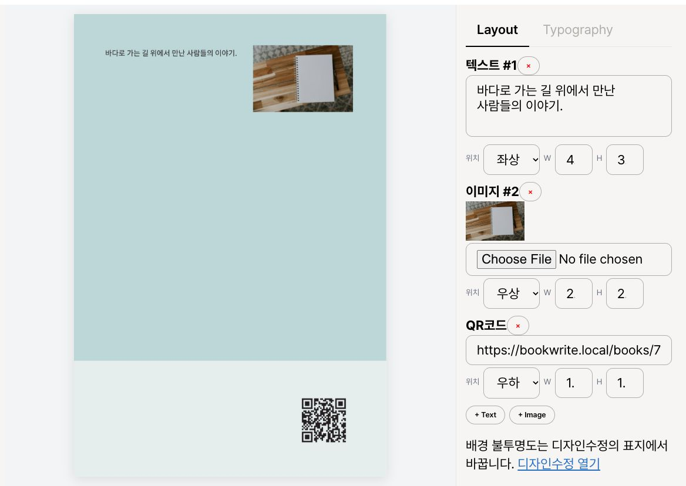

## 뒷표지 배치

뒤표지에는 소개글, 그림, QR코드를 원하는 자리에 놓을 수 있습니다. **표지 편집** 탭의 미리보기에서 뒤표지를 누르거나, 왼쪽 목차의 **표지 › 뒤표지** 를 누르면 편집 화면이 열립니다.



## 항목 추가

**Layout** 탭 아래쪽의 버튼으로 항목을 추가합니다.

- **+ Text** — 글 상자
- **+ Image** — 그림
- **+ QR** — 주소로 만드는 QR코드. 하나만 넣을 수 있어서, 이미 있으면 버튼이 사라집니다.

항목을 지우려면 항목 오른쪽 위의 \*\*×\*\*를 누릅니다.

## 내용 넣기

- **텍스트** — 칸에 글을 씁니다. `## `로 시작하는 줄은 크고 굵은 제목이 되고, ` **굵게** `로 감싼 부분은 굵은 글씨가 됩니다. 줄마다 단락이 나뉩니다.
- **이미지** — 파일을 골라 올립니다. 그림은 비율을 지킨 채 항목 상자에 맞춰집니다.
- **QR코드** — 주소(`https://...`)를 넣습니다. 처음에는 **책 설정 › 책 기본 정보** 의 **QR URL** 이 들어갑니다.

예시:

```
## 올해의 소설

**한번 읽으면 멈출 수 없는 이야기.** 한 남자의 긴 여정을 따라갑니다.
```

## 위치와 크기

뒤표지의 안쪽(가장자리 여백을 뺀 부분)은 가로 6칸, 세로 12칸으로 나뉘어 있습니다. 항목마다 세 가지를 정합니다.

- **위치** — 아홉 기준점 중 하나입니다. 항목이 이 자리에 붙습니다.

```
좌상 중상 우상
좌중 중앙 우중
좌하 중하 우하
```

- **W** (너비) — 0.5칸에서 6칸까지, 0.5칸 단위
- **H** (높이) — 0.5칸에서 12칸까지, 0.5칸 단위

## 저장

**저장** 을 누르면 표지 전체가 다시 배치되고 미리보기에 바로 보입니다. 미리보기에서 항목을 누르면 그 항목의 칸으로 이동합니다.

## 바코드와 불투명도

- **ISBN 바코드** 는 따로 넣지 않아도 됩니다. **책 설정 › 책 기본 정보** 에 ISBN을 넣으면 뒤표지 오른쪽 아래에 바코드와 번호가 찍힙니다. 바코드 아래에는 흰 바탕이 깔려 어떤 배경에서도 읽힙니다.
- **배경 불투명도** 는 책에 자기 디자인이 있으면 [디자인수정](/10/bookwrite/122/-)의 **표지 › 뒷표지** 에서 바꿉니다. 자기 디자인이 없는 책은 Layout 탭 맨 아래의 **이미지 투명도** 막대로 조절합니다.
- 글자 모양(글꼴, 크기, 색, 정렬)도 디자인수정의 **표지 › 뒷표지 › 글자** 에서 정합니다. 편집 화면의 **Typography** 탭에는 안내만 있습니다.

디자인에 표지가 들어 있는 책은 뒤표지의 글만 디자인에 정해진 자리에 들어가고, 위치·크기와 그림, QR코드는 쓰이지 않습니다([표지](/10/bookwrite/124/-) 참고).

배경 그림 올리기와 표지 다시 만들기는 [표지](/10/bookwrite/124/-)를 보세요.