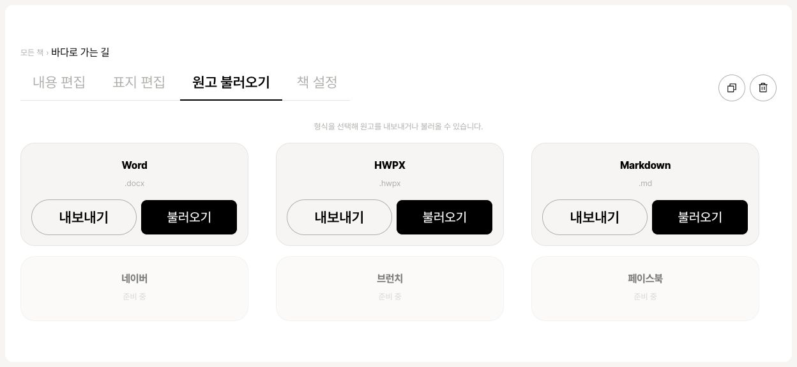
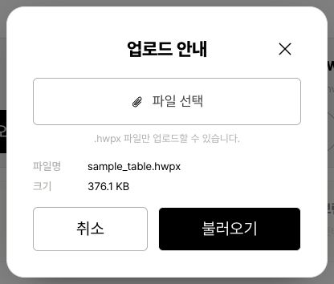

## 원고 불러오기와 내보내기

책의 원고를 Word, 한글(HWPX), 마크다운 파일로 내려받아 익숙한 프로그램에서 고친 뒤, 다시 BookWrite로 불러올 수 있습니다.

## 원고 불러오기 탭

책 위쪽의 **원고 불러오기** 탭을 누르면 형식별 카드가 나옵니다.

| 카드 | 파일 |
| --- | --- |
| **Word** | `.docx` |
| **HWPX** | `.hwpx` (한컴오피스 한글) |
| **Markdown** | `.md` |
| **네이버** , **브런치** , **페이스북** | 준비 중 |

카드마다 **내보내기** 와 **불러오기** 버튼이 있습니다.

## 내보내기

**내보내기** 를 누르면 책 전체가 파일 하나로 내려받아집니다.

- **Word** , **HWPX** — 문서마다 제목이 붙어 나뉩니다. 한글 파일은 `1장: 제목`, `서문: 제목`처럼, Word 파일은 `Chapter 1: 제목`, `Prologue: 제목`처럼 문서 종류가 제목 앞에 붙습니다. 화보는 들어가지 않습니다.
- **Markdown** — 문서마다 맨 위에 `title:`이 적힌 머리말 블록이 붙고, 그 아래에 본문이 이어집니다.

## 불러오기

1. 카드의 **불러오기** 를 누릅니다.
2. **업로드 안내** 창에서 **파일 선택** 을 눌러 고친 파일을 고릅니다. 고른 파일의 **파일명** 과 **크기** 가 보입니다.
3. 창 아래의 **불러오기** 를 누릅니다.

불러오기가 끝나면 책 개요로 돌아가 "3개 챕터가 업데이트되었습니다."처럼 바뀐 문서 수를 알려 줍니다.

## 제목으로 맞춰 넣습니다

불러온 파일은 문서 제목으로 책의 문서와 짝을 짓습니다. 제목 앞의 `1장:`, `서문:` 같은 표시는 빼고 비교하며, 대소문자와 문장부호 차이는 무시합니다.

- **제목이 맞는 문서** — 본문이 파일의 내용으로 바뀝니다.
- **제목이 맞는 문서가 없는 부분** — 건너뛰고, "매칭되지 않은 섹션: …"으로 그 제목을 알려 줍니다.
- **파일에 없는 문서** — 그대로 둡니다. 불러오기로 새 문서가 생기거나 문서가 지워지지는 않습니다.
- **화보** — 불러오기로 바뀌지 않습니다.

> **주의 (Word, HWPX)**: 큰 제목(`#`)과 중간 제목(`##`)은 모두 새 문서의 시작으로 읽습니다. 그래서 문서 안에 넣은 이런 소제목은 소제목으로 남지 않고 따로 짝을 찾는 부분이 됩니다. 또 `- `로 시작하는 목록 줄은 지워지므로 글머리표 목록은 들어오지 않습니다. 소제목이나 목록을 고쳤다면 마크다운 파일로 주고받으세요.

> **중요** : 내보낸 파일에서 문서 제목은 고치지 마세요. 제목이 바뀌면 짝을 찾지 못해 그 문서는 건너뜁니다. 제목을 바꾸려면 BookWrite의 목차에서 바꿉니다.

> **참고** : 불러오면 짝이 맞은 문서의 본문은 파일의 내용으로 통째로 바뀝니다. 내보낸 뒤 BookWrite에서 고친 내용은 사라지니, 한쪽에서만 고치세요.

## 작업 순서

1. **원고 불러오기** 탭에서 원하는 형식의 **내보내기** 를 누릅니다.
2. 내려받은 파일을 Word, 한글, 또는 텍스트 편집기에서 엽니다.
3. 본문을 고칩니다. 제목 줄은 그대로 둡니다.
4. 저장한 뒤 같은 카드의 **불러오기** 로 올립니다.
5. 책 개요에 나온 결과를 확인하고, 건너뛴 문서가 있으면 제목을 확인합니다.

인디자인 파일은 [인디자인(IDML)으로 내보내기](/10/bookwrite/129/idml)에서 다룹니다.