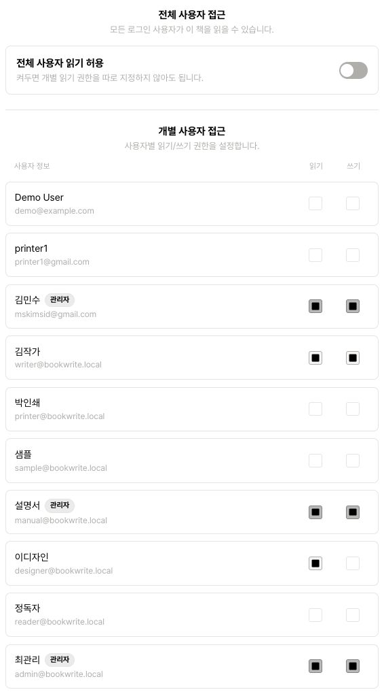
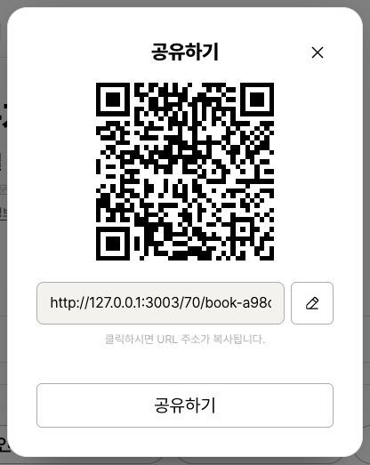
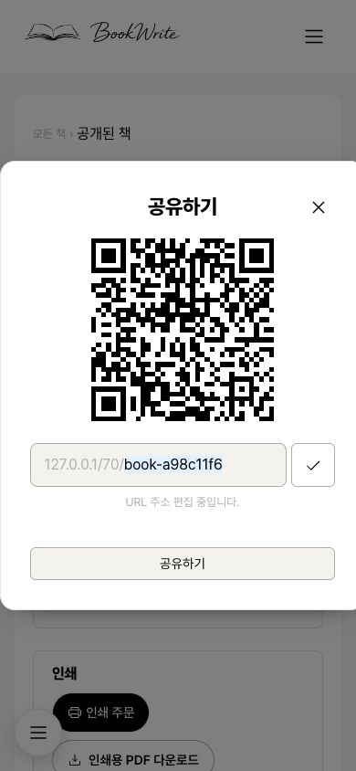

## 웹에 공개하기

책을 읽을 수 있는 사람은 두 가지로 정해집니다.

- **이 BookWrite의 사용자** — 책의 **책 설정 › 권한 설정** 에서 정합니다. **전체 사용자 읽기 허용** 을 켜면 로그인한 모든 사용자가 읽고, 켜지 않으면 **개별 사용자 접근** 에서 **읽기** 나 **쓰기** 를 고른 사람만 읽습니다([역할과 초대](/10/bookwrite/111/-)).
- **웹의 누구나** — 웹에 공개된 책은 로그인하지 않은 방문자도 읽을 수 있습니다.

## 웹에 공개된 책

공개된 책은 BookWrite 주소 뒤에 책 번호와 이름이 붙은 주소를 가집니다. 예를 들어 `books.example.com/12/my-book`입니다. 방문자는 이 주소로 바로 책을 열고, 목차와 검색으로 읽습니다([읽기](/10/bookwrite/130/-)).

로그인하지 않고 BookWrite의 첫 주소로 들어온 방문자에게는 공개된 책의 목록이 나옵니다. 공개된 책이 하나도 없으면 로그인 화면이 나옵니다.

지금은 책 화면에서 웹 공개를 켜거나 끄는 단추가 없습니다. 책을 웹에 공개하려면 관리자에게 문의하세요.

## 공유하기

공개된 책에는 책 화면 오른쪽 위에 **공유하기** 단추(공유 아이콘)가 나옵니다. 누르면 **공유하기** 창이 열립니다.

- **QR 코드** — 휴대폰 카메라로 찍으면 책이 열립니다. 인쇄물이나 발표 화면에 넣기 좋습니다.
- **주소 칸** — 누르면 주소가 복사되고, 아래에 \*\*URL 주소가 복사되었습니다.\*\*가 나옵니다. 메일이나 메신저에 붙여 넣으면 됩니다.
- **공유하기** — 휴대폰처럼 공유 기능이 있는 기기에서는 기기의 공유 메뉴가 열립니다.

## 주소 바꾸기

쓰기 권한이 있으면 주소 칸 옆에 연필 단추가 있습니다. 누르면 주소의 끝부분(책 번호 뒤)을 고칠 수 있고, 아래에 \*\*URL 주소 편집 중입니다.\*\*가 나옵니다. 영문 글자, 숫자, 하이픈(-)만 쓸 수 있습니다. 체크 단추를 누르면 저장하고, Esc를 누르면 취소합니다.

책은 주소의 책 번호로 찾으므로, 끝부분을 바꾼 뒤에도 예전 주소로 책이 열립니다.

끝부분은 처음에 책 제목으로 만들어집니다. 한글 제목처럼 영문으로 바꿀 수 없는 제목이면 `book-`으로 시작하는 임의의 이름이 붙으니, 알아보기 쉬운 이름으로 바꿔 두세요. 나중에 책 제목을 바꾸면 끝부분도 새 제목에 맞춰 다시 만들어집니다. 그 뒤에 다시 고쳐 주세요.

