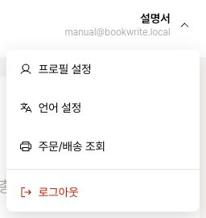
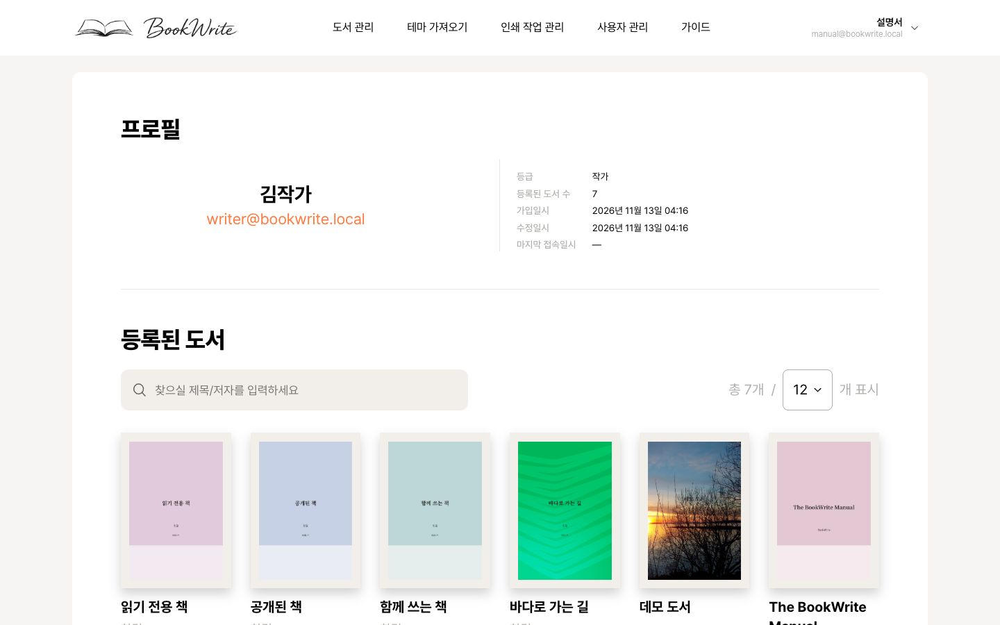

## 도움말

누구나 가끔은 막힙니다. 자주 생기는 상황을 모았습니다.

## 설명서 보기

상단 메뉴의 **가이드** 를 누르면 이 설명서가 새 탭에서 열립니다. 도서 관리에 있는 **BookWrite 사용 설명서** 책으로도 읽을 수 있고, 이 책에서는 목차 위의 **검색** 칸으로 원하는 내용을 찾을 수 있습니다.

## 처음 가입하면 받는 책

계정이 처음 만들어지면, 모든 사용자에게 열려 있는 책( **BookWrite 사용 설명서** 같은 책)이 한 부씩 복제되어 내 책으로 도서 관리에 들어옵니다. 제목은 원본과 같습니다. 내 사본이므로 고치거나 지워도 다른 사람에게는 영향이 없고, 연습장으로 써도 됩니다. 복제에 대해서는 [복제와 삭제](/10/bookwrite/135/-)를 보세요.

## 내 프로필과 비밀번호

오른쪽 위의 내 이름을 누르면 메뉴가 열립니다. 휴대폰처럼 화면이 좁으면 내 이름 대신 ☰ 단추가 있고, 누르면 내 이름 아래에 **도서 관리** , **사용자 관리** , **가이드** 같은 위쪽 메뉴가 먼저 나오고, 그 아래에 다음 항목이 이어집니다.

- **프로필 설정** — 비밀번호를 바꿉니다. **현재 비밀번호** , **새 비밀번호** , **새 비밀번호 확인** 을 입력하고 **변경 사항 저장** 을 누르세요. 이름과 이메일은 여기서 바꿀 수 없습니다. 아래쪽에는 **회원탈퇴** 도 있습니다.
- **언어 설정** — 화면의 언어를 고릅니다. 한국어와 English를 비롯해 11개 언어가 있습니다. 로그인하기 전에는 로그인 화면의 언어 선택 상자를 쓰세요.
- **주문/배송 조회** — 아직 준비 중입니다. 지금은 책 개요의 **주문 내역** 에서 그 책의 인쇄 주문을 확인하세요.
- **로그아웃**

**사용자 관리** 에서 사람의 이름을 누르면 그 사람의 **프로필** 이 열립니다. 등급, 등록된 도서 수, 가입일, 마지막 접속일시와 그 사람이 등록된 책 목록이 보입니다. 내 프로필에서는 **프로필 편집** 으로 프로필 설정에 갈 수 있습니다.

## 다른 기기에서 로그인하기

다른 컴퓨터나 휴대폰에서는 같은 이메일과 비밀번호로 로그인하면 됩니다. 여러 기기에서 동시에 로그인해 있어도 괜찮습니다.

## 비밀번호를 잊었을 때

지금은 앱 안에서 비밀번호를 다시 설정하는 기능이 없습니다. BookWrite를 운영하는 관리자에게 문의해 주세요.

## 책이 보이지 않을 때

도서 관리에는 내가 읽거나 쓸 수 있는 책과 웹에 공개된 책이 나옵니다. 다른 사람의 책이 보이지 않는다면, 그 책에 쓰기 권한이 있는 사람에게 **책 설정** › **권한 설정** 에서 나를 추가해 달라고 하세요. [역할과 초대](/10/bookwrite/111/-)를 보세요.

## 버전 확인

로그인 화면 아래에 지금 쓰고 있는 BookWrite의 버전이 나옵니다. 문제를 알릴 때 함께 알려 주시면 도움이 됩니다.

행복한 글쓰기가 되시길 바랍니다!